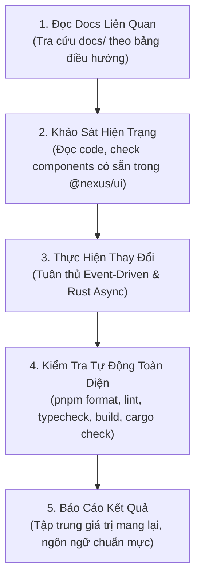

# Nexus Agent Engineering Guidelines & Documentation Index

Tài liệu này là chỉ dẫn vận hành bắt buộc dành cho mọi AI Coding Agent (Antigravity, Claude, Cursor, Copilot, Roo-Code, v.v.) khi làm việc trong kho mã nguồn **Nexus**.

---

## 🚨 NGUYÊN TẮC VÀNG: BẮT BUỘC ĐỌC `docs/` TRƯỚC KHI CODE

Trước khi sửa đổi hoặc viết thêm bất kỳ dòng code nào, Agent **BẮT BUỘC** phải đọc các tài liệu kỹ thuật liên quan trong thư mục [`docs/`](file:///Users/lethanhba/workspace/app/nexus/docs). Không được phỏng đoán quy chuẩn kiến trúc hay tự sáng chế ra các pattern mới trái với quy ước của hệ thống.

### Bản Đồ Tài Liệu (`docs/` Navigation Map)

| Khi Agent cần làm...                                              | Bắt buộc đọc tài liệu này                                                                                   | Nội dung trọng tâm cần nắm                                                                                                                    |
| :---------------------------------------------------------------- | :---------------------------------------------------------------------------------------------------------- | :-------------------------------------------------------------------------------------------------------------------------------------------- |
| **Viết code TypeScript, React, Rust hoặc chuẩn bị gửi commit/PR** | 👉 [`docs/coding-standards.md`](file:///Users/lethanhba/workspace/app/nexus/docs/coding-standards.md)       | Naming conventions, cấm lạm dụng `useEffect`, Rust `spawn_blocking`, lưu Keychain `keyring`, cấu trúc thư mục, Checklist PR.                  |
| **Thiết kế UI, sửa giao diện, chỉnh style, màu sắc, khoảng cách** | 👉 [`docs/ui-ux-design-system.md`](file:///Users/lethanhba/workspace/app/nexus/docs/ui-ux-design-system.md) | Thẩm mỹ Dark-first macOS, không lạm dụng card/border, typography, spacing scale, icon `lucide-react`, Definition of Done cho UI.              |
| **Tạo mới một mini app trong `apps/`**                            | 👉 [`docs/mini-app-guide.md`](file:///Users/lethanhba/workspace/app/nexus/docs/mini-app-guide.md)           | Kiến trúc 4 bước xây mini app, dùng chung `@nexus/ui`, `MiniAppHeader` (Overlay Titlebar), `AppSplashScreen`, `AsyncContent`, `useAsyncTask`. |
| **Phát triển hoặc tham khảo tính năng của `apps/github-report`**  | 👉 [`docs/github-report.md`](file:///Users/lethanhba/workspace/app/nexus/docs/github-report.md)             | Kiến trúc tham chiếu mẫu: Event-Driven data flow, Local AI CLI (Claude/Antigravity), macOS Keychain PAT, `tauri-plugin-store`.                |
| **Tìm hiểu cấu trúc monorepo, Turborepo, IPC giữa các ứng dụng**  | 👉 [`docs/architecture.md`](file:///Users/lethanhba/workspace/app/nexus/docs/architecture.md)               | Monorepo layout, pnpm workspaces, cách Nexus Launcher quản lý và giao tiếp với các mini app con.                                              |
| **Cài đặt môi trường, công cụ CLI hoặc cấu hình máy dev**         | 👉 [`docs/prerequisites.md`](file:///Users/lethanhba/workspace/app/nexus/docs/prerequisites.md)             | Phiên bản Node, pnpm, Rust, Tauri CLI, GitHub CLI `gh`, quyền truy cập Accessibility & Automation trên macOS.                                 |

---

## 🏛️ Quy Chuẩn Kiến Trúc Bắt Buộc (Core Guardrails)

### 1. Kiến Trúc Frontend (React 19 + TypeScript)

- **Tái sử dụng tối đa `@nexus/ui`**:
  - Không tự viết lại các thành phần cơ bản (Header, StatusBar, Splash, Modal, Button, Loading, Card, Tooltip, ContextMenu).
  - Mọi mini app bắt buộc kế thừa `MiniAppShell`, `MiniAppHeader` (đảm bảo khoảng an toàn 76px Traffic Lights và `data-tauri-drag-region`), `AppSplashScreen`, và `AsyncContent`.
- **Triết lý Event-Driven — Nghiêm cấm lạm dụng `useEffect`**:
  - `useEffect` **CHỈ** dùng làm escape hatch để đồng bộ với môi trường bên ngoài (ví dụ gán event listener cửa sổ).
  - **TUYỆT ĐỐI KHÔNG** dùng `useEffect` để tính toán derived state (dùng `useMemo` hoặc tính trực tiếp).
  - **TUYỆT ĐỐI KHÔNG** dùng `useEffect` để kích hoạt fetch dữ liệu hoặc business logic. Mọi tác vụ async phải được kích hoạt từ **User Event** (Click, Form Submit, Hotkey) hoặc sự kiện `onReady` duy nhất từ `useAppBootstrap`.
  - Quản lý tác vụ async bằng `useAsyncTask` từ `@nexus/ui` để tận dụng cơ chế latest-wins, deduplication, và Stale-While-Revalidate.
- **Ổn định Reference**:
  - Sử dụng `useLatestRef` cho các giá trị cấu hình/state khi cần truy cập trong callback async mà không muốn re-run effect hoặc re-create handler.

### 2. Kiến Trúc Backend (Rust + Tauri v2)

- **Bảo toàn khả năng phản hồi của IPC (Non-blocking IPC)**:
  - Mọi lệnh Tauri command thực thi I/O (gọi process CLI ngoài `gh`/`claude`/`agy`, chạy AppleScript, truy vấn ổ đĩa, HTTP) **BẮT BUỘC** phải là `pub async fn`.
  - Bọc toàn bộ các tác vụ blocking bên trong `tauri::async_runtime::spawn_blocking(...)`.
  - Nghiêm cấm chạy các lệnh blocking đồng bộ trực tiếp trên luồng IPC vì sẽ khiến cửa sổ macOS ngưng phản hồi.
- **Xử lý lỗi & Kiểu dữ liệu**:
  - Không dùng `.unwrap()` hoặc `.expect()` trong ngữ cảnh runtime; luôn trả về `Result<T, String>` để frontend bắt lỗi an toàn.
  - Quản lý bảo mật: Token và Secret nhạy cảm phải lưu vào macOS Keychain qua crate `keyring`, không lưu plain-text trong file JSON hay localStorage.

### 3. Tiêu Chuẩn Thiết Kế UI/UX (macOS Native Experience)

- **Bản sắc Dark-first macOS**:
  - Giữ vững bảng màu tối trang nhã, điểm xuyết bằng màu nhấn Cyan/Sky (`#38bdf8` / `#0284c7`).
  - Phân tầng bằng độ sâu bề mặt (surface background tones), **KHÔNG bọc card lồng card** hoặc bao quanh mọi thành phần bằng border dày.
- **Tính toán và căn chỉnh**:
  - Tuân thủ thang đo khoảng cách chuẩn (spacing scale: 4px, 8px, 12px, 16px, 24px).
  - Sử dụng typography phân cấp rõ ràng, hỗ trợ hoàn hảo tiếng Việt và tiếng Anh.
  - Sử dụng bộ icon đồng nhất từ `lucide-react`.

---

## 🔄 Quy Trình 5 Bước Làm Việc Của Agent (Agent Workflow)

Mỗi khi nhận một yêu cầu phát triển hoặc bảo trì, Agent phải tuân thủ nghiêm ngặt chu trình sau:



### Bước 1: Tra cứu tài liệu chuyên biệt

- Mở và đọc các file markdown trong `docs/` tương ứng với phạm vi công việc.

### Bước 2: Khảo sát mã nguồn hiện có

- Tìm kiếm trong `packages/ui` và `packages/shared` xem đã có component, type, hook hoặc util nào giải quyết được bài toán chưa.
- Tuyệt đối không cài thêm thư viện phụ thuộc mới (`npm install`) nếu không có sự đồng ý của người dùng.

### Bước 3: Triển khai mã nguồn

- Giữ nguyên cấu trúc thư mục chuẩn: `components/`, `hooks/`, `services/`, `lib/`, `types/`.
- Tuân thủ quy ước đặt tên: file `kebab-case`, component `PascalCase`, hook `useCamelCase`.

### Bước 4: Kiểm định chất lượng bắt buộc (Verification Gate)

Trước khi hoàn tất turn làm việc, Agent **BẮT BUỘC** phải chạy các lệnh sau:

```bash
# 1. Format code theo chuẩn Prettier
pnpm format

# 2. Kiểm tra lỗi linter
pnpm lint

# 3. Kiểm tra kiểu dữ liệu TypeScript toàn monorepo
pnpm typecheck

# 4. Kiểm tra build frontend và backend (khi có thay đổi logic)
pnpm build
cargo check --manifest-path apps/github-report/src-tauri/Cargo.toml
cargo check --manifest-path apps/nexus/src-tauri/Cargo.toml
```

### Bước 5: Báo cáo & Tài liệu hóa

- Báo cáo kết quả ngắn gọn, chuyên nghiệp, dẫn link file trực tiếp (`[file.tsx](file:///path)`).
- Không đưa các thuật ngữ debug nội bộ hoặc than phiền lỗi lập trình vào phần mô tả tính năng.
