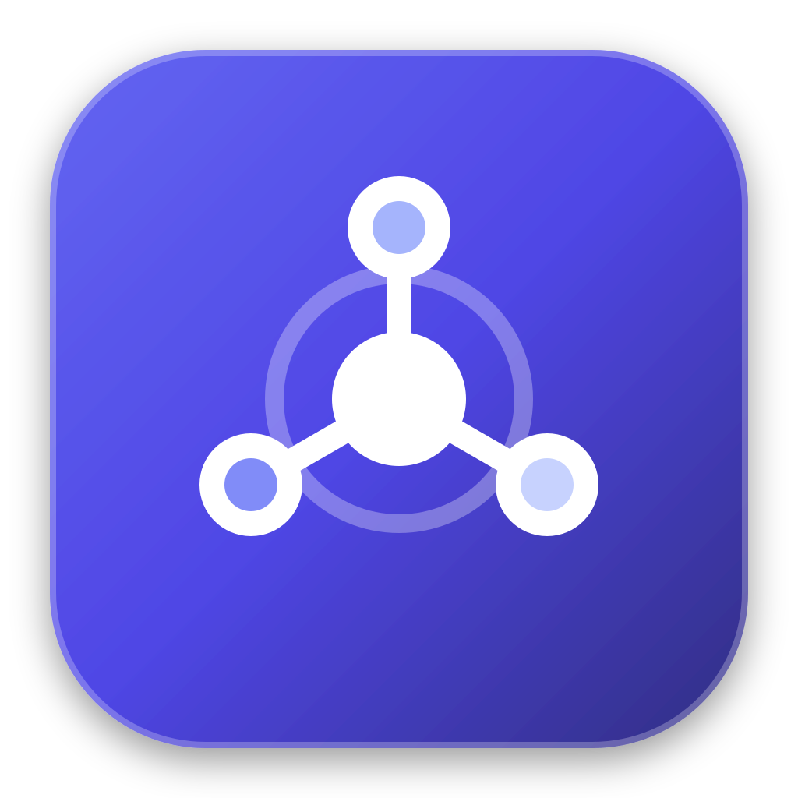

# 🪐 Nexus — macOS Mini App Ecosystem

<p align="center">
  
</p>

<p align="center">
  <strong>Nền tảng Launchpad & Hệ sinh thái Mini App độc lập siêu nhẹ trên macOS</strong><br />
  Xây dựng bằng <strong>Tauri v2 + Rust + React 19 + TypeScript + Vite + Tailwind CSS</strong> trong mô hình Monorepo.
</p>

<p align="center">
  <a href="https://github.com/thanhba0505/nexus/releases/latest">
    
  </a>
  
  
  
</p>

---

## 🚀 Tải Về & Cài Đặt (Quick Download & Installation)

Bạn chỉ cần tải ứng dụng **Nexus Hub** duy nhất. Nexus đóng vai trò là trạm điều khiển trung tâm (Launchpad), giúp bạn mở, quản lý và sử dụng tất cả các mini apps khác trong hệ sinh thái mà không cần cài đặt rời rạc từng ứng dụng.

### 📥 Tải Bản Phát Hành Mới Nhất

<!-- NEXUS_DOWNLOAD_SECTION_START -->

> 💡 **Bấm trực tiếp vào nút bên dưới để tải ngay file cài đặt `.dmg` về máy (Direct Download)**:

<p align="center">
  <a href="https://github.com/thanhba0505/nexus/releases/download/v0.5.0/Nexus_0.5.0_aarch64.dmg">
    
  </a>
</p>

| Thông Tin Phát Hành               | Chi Tiết                                                                                                           |
| :-------------------------------- | :----------------------------------------------------------------------------------------------------------------- |
| 🏷️ **Phiên Bản Hiện Tại**         | `v0.5.0`                                                                                                           |
| 📦 **Tệp Cài Đặt Khuyên Dùng**    | [`Nexus_0.5.0_aarch64.dmg`](https://github.com/thanhba0505/nexus/releases/download/v0.5.0/Nexus_0.5.0_aarch64.dmg) |
| ⚡ **Cách Thức Tải**              | **Tải Trực Tiếp (Direct Download)** — Trình duyệt tự tải file về, không cần qua trang trung gian                   |
| 📋 **Xem Chi Tiết Bản Phát Hành** | [📦 Xem GitHub Releases & Changelog](https://github.com/thanhba0505/nexus/releases/latest)                         |

<!-- NEXUS_DOWNLOAD_SECTION_END -->

---

### 💻 Hướng Dẫn Cài Đặt Trên macOS

1. Nhấn vào nút **Tải Ngay** ở trên để tải file `Nexus_..._aarch64.dmg` về thư mục Downloads.
2. Click đúp vào file `.dmg` vừa tải để mở đĩa cài đặt.
3. Kéo biểu tượng **Nexus** thả vào thư mục **Applications**.
4. Mở **Nexus** từ Launchpad, thư mục Applications hoặc qua Spotlight (`⌘ + Space`).

> [!TIP]
> **Xử lý khi macOS hiện thông báo "App cannot be opened because it is from an unidentified developer":**
>
> - **Cách 1 (Khuyên dùng)**: Mở Finder vào thư mục `/Applications`, click chuột phải (hoặc giữ phím `Control` + click) vào **Nexus** $\rightarrow$ chọn **Open** $\rightarrow$ chọn tiếp **Open** ở hộp thoại xác nhận. Bạn chỉ cần thực hiện thao tác này đúng một lần đầu tiên.
> - **Cách 2**: Chạy một dòng lệnh Terminal:
>   ```bash
>   xattr -cr /Applications/Nexus.app
>   ```

---

## 📱 Các Ứng Dụng Trong Hệ Sinh Thái Nexus

Mỗi ứng dụng trong Nexus là một **macOS Native Application Bundle (`.app`) độc lập** có Process ID, cửa sổ và vòng đời riêng biệt, nhưng được liên kết và điều khiển đồng bộ thông qua Nexus Hub.

```
+---------------------------------------------------------------------------------------+
|                                    NEXUS ECOSYSTEM                                    |
+---------------------------------------------------------------------------------------+
|                                                                                       |
|   ┌───────────────────────────────────────────────────────────────────────────────┐   |
|   │                           🪐 NEXUS LAUNCHPAD HUB                              │   |
|   │         Trạm điều khiển trung tâm • App Grid • App Store • Đồng bộ trạng thái │   |
|   └──────────────────────┬────────────────────────────────┬───────────────────────┘   |
|                          │                                │                           |
|                          ▼                                ▼                           |
|   ┌──────────────────────────────────────────┐     ┌──────────────────────────────┐   ┌──────────────────────────────┐   |
|   │            📊 GITHUB REPORT              │     │         💬 SLACKBOT          │   │          🐾 2D PET           │   |
|   │  Quét PRs & commits • Local AI Standup   │     │  Tự động hóa Slack • Webhook │   │  Anime Chibi Desktop Mascot  │   |
|   │  Phím tắt macOS • Bảo mật Keychain       │     │  Thông báo công việc tức thì │   │  Gravity Physics • Shimeji   │   |
|   └──────────────────────────────────────────┘     └──────────────────────────────┘   └──────────────────────────────┘   |
|                                                                                                                          |
+--------------------------------------------------------------------------------------------------------------------------+
```

### 1. 🪐 Nexus Hub (`apps/nexus`)

- **Vai trò**: Trạm điều khiển trung tâm và bệ phóng (Launchpad) cho toàn bộ hệ sinh thái.
- **Tính năng nổi bật**:
  - Giao diện Acrylic kính mờ (macOS Vibrancy) chuẩn phong cách Apple.
  - Quản lý danh sách mini app dạng lưới (App Grid) hỗ trợ click chọn, double-click mở app.
  - Tự động đồng bộ trạng thái mở/đóng của các ứng dụng theo thời gian thực.
  - Tích hợp cửa hàng Mini App Store nội bộ và menu chuột phải thông minh.

### 2. 📊 GitHub Report (`apps/github-report`)

- **Vai trò**: Tự động tổng hợp kết quả công việc trong ngày và báo cáo Daily Standup.
- **Tính năng nổi bật**:
  - **Tự động quét Pull Request & Commits**: Thu thập nhanh hoạt động GitHub theo ngày (Hôm nay hoặc Ngày làm việc trước cho sáng thứ Hai).
  - **Tóm tắt Daily Standup bằng AI thông minh**: Tự động nhóm công việc và tạo 3-4 dòng tóm tắt súc tích bằng Local AI (Claude CLI, Antigravity CLI - không tốn phí token) hoặc Cloud API.
  - **Chỉnh sửa & Tùy biến nhanh (Inline Edit)**: Bật/tắt từng PR/commit bằng checkbox và sửa trực tiếp nội dung tóm tắt trước khi gửi.
  - **Tích hợp quy trình 1-Click**: Tự động sao chép vào Clipboard và mở tab **Parabol / Slack / Notion** trên trình duyệt (Brave, Chrome, Safari, Arc).
  - **Bảo mật phần cứng**: Lưu trữ an toàn GitHub Token và API keys trong **macOS Keychain** qua chip Apple Secure Enclave.

### 3. 💬 SlackBot (`apps/slackbot`)

- **Vai trò**: Trợ lý tự động hóa công việc và tương tác nhanh với workspace Slack.
- **Tính năng nổi bật**: Gửi thông báo tự động, nhận webhook công việc, quản lý lịch nhắc việc nội bộ.

### 4. 🐾 2D Pet (`apps/pet-2d`)

- **Vai trò**: Nhân vật ảo Anime Chibi (Desktop Companion / Shimeji) đồng hành giải tỏa căng thẳng trên macOS.
- **Tính năng nổi bật**:
  - Cửa sổ vô hình 100% trong suốt, không viền, không cản trở chuột khi làm việc.
  - Động cơ vật lý trọng lực: rơi tự do, chạm sàn nảy nhẹ, leo trèo viền màn hình và nhảy dù xuống.
  - Thao tác kéo thả native (`startDragging`) nhấc bổng nhân vật đi khắp màn hình.
  - Menu chuột phải Dark Glassmorphism: chỉnh kích thước (1x/1.5x/2x), tốc độ, ghim vị trí, đổi bộ sprite Shimeji.
  - Đóng gói sẵn 13 frames bé Anya Forger và hỗ trợ kéo thả folder ảnh Shimeji từ máy tính.
  - Đặc tả chi tiết: 👉 [`docs/pet-2d.md`](docs/pet-2d.md).

---

## 🏛️ Kiến Trúc Kỹ Thuật (Architecture Highlights)

| Tiêu Chí                | Nexus Ecosystem (Tauri v2 + Rust)                         | Các Giải Pháp Dựa Trên Electron            |
| :---------------------- | :-------------------------------------------------------- | :----------------------------------------- |
| **Tiêu Thụ RAM**        | **~30MB - 50MB** mỗi ứng dụng                             | >250MB - 500MB mỗi ứng dụng                |
| **Dung Lượng Bộ Cài**   | **~2MB - 5MB** (`.dmg`)                                   | >80MB - 150MB                              |
| **Thời Gian Khởi Động** | Khởi động tức thì (<400ms kèm Splash Screen)              | Trễ 2s - 4s nạp Chromium runtime           |
| **Cửa Sổ & Giao Diện**  | Native WKWebView + macOS Acrylic Vibrancy                 | Giả lập kính mờ CSS gây tụt FPS            |
| **Bảo Mật Cấu Hình**    | `tauri-plugin-store` (Application Support) + **Keychain** | Thường lưu plain-text trong `localStorage` |
| **Vòng Đời App**        | Mỗi mini app là một `.app` riêng biệt, chạy độc lập       | Buộc phải phụ thuộc vào cửa sổ mẹ          |

---

## 📁 Cấu Trúc Mã Nguồn Monorepo

```text
nexus/
├── apps/
│   ├── nexus/               # App chính: Nexus Launchpad Hub (Cổng 1420)
│   ├── github-report/       # Mini App: GitHub PR Monitor & Standup AI (Cổng 1422)
│   ├── slackbot/            # Mini App: Slack Assistant & Automation (Cổng 1421)
│   └── pet-2d/              # Mini App: 2D Anime Chibi Mascot & Physics (Cổng 1423)
├── packages/
│   ├── config/              # @nexus/config: Tailwind presets, ESLint 9, TSConfigs
│   ├── shared/              # @nexus/shared: Registry apps, kiểu dữ liệu dùng chung
│   └── ui/                  # @nexus/ui: Thư viện components & hooks chuẩn mini app
│       ├── components/      # MiniAppShell, MiniAppHeader, AppSplashScreen, AsyncContent...
│       └── hooks/           # useAsyncTask, useAppBootstrap, useHotkeys, useLatestRef...
├── tooling/
│   ├── assets/              # File icon SVG nguồn (nexus, github-report, slackbot)
│   └── scripts/             # Shell scripts: check-env.sh, generate-icons.sh
├── docs/                    # Hệ thống tài liệu kỹ thuật toàn diện
│   ├── mini-app-guide.md    # Hướng dẫn chi tiết 4 bước xây dựng Mini App chuẩn
│   ├── github-report.md     # Tài liệu đặc tả kiến trúc GitHub Report
│   ├── coding-standards.md  # Quy chuẩn lập trình Monorepo & tiêu chuẩn IPC Rust
│   ├── architecture.md      # Thiết kế kiến trúc tổng quan & so sánh công nghệ
│   └── prerequisites.md     # Hướng dẫn cài đặt môi trường máy local
├── Cargo.toml               # Cargo Workspace root (chia sẻ chung /target/ build cache)
├── pnpm-workspace.yaml      # Khai báo pnpm workspaces
├── turbo.json               # Pipeline build và cache Turborepo
├── package.json             # Root scripts & dependencies
└── README.md
```

---

## 🛠️ Hướng Dẫn Phát Triển Cho Lập Trình Viên (Developer Guide)

### 1. Môi Trường Tiên Quyết

- **macOS**: Phiên bản 13.0 (Ventura) trở lên (Apple Silicon M1/M2/M3/M4 hoặc Intel).
- **Node.js**: v20+ hoặc v22+ (kèm `pnpm` qua Corepack: `corepack enable pnpm`).
- **Rust & Cargo**: Cài đặt qua `curl --proto '=https' --tlsv1.2 -sSf https://sh.rustup.rs | sh`.

Kiểm tra nhanh môi trường bằng script tự động:

```bash
./tooling/scripts/check-env.sh
```

### 2. Cài Đặt Dependencies

```bash
pnpm install
```

### 3. Chạy Môi Trường Phát Triển (Development)

```bash
# Mở đồng thời cả 3 app và hiển thị cửa sổ Nexus Launchpad
pnpm dev

# Mở riêng từng cửa sổ Desktop:
pnpm dev:nexus          # Mở cửa sổ Nexus Hub (Cổng 1420)
pnpm dev:github-report  # Mở cửa sổ GitHub Report (Cổng 1422)
pnpm dev:slackbot       # Mở cửa sổ SlackBot (Cổng 1421)

# Chạy cả 3 app ở chế độ Web trong trình duyệt (không mở cửa sổ desktop)
pnpm dev:web
```

### 4. Kiểm Tra Chất Lượng Mã Nguồn (Lint, Typecheck & Format)

```bash
# Kiểm tra TypeScript Strict Mode toàn monorepo
pnpm typecheck

# Kiểm tra ESLint
pnpm lint

# Format code bằng Prettier
pnpm format
```

### 5. Đóng Gói Bộ Cài macOS Native (.dmg)

```bash
# Đóng gói bộ cài Nexus Hub (.dmg)
pnpm build:nexus

# Đóng gói bộ cài GitHub Report (.dmg)
pnpm build:github-report

# Đóng gói bộ cài SlackBot (.dmg)
pnpm build:slackbot
```

File `.dmg` hoàn chỉnh sẽ nằm trong thư mục `target/release/bundle/dmg/`.

---

## 🤖 Cơ Chế Tự Động Hóa Release Của Bot (Release Drafter & Publisher)

Dự án tích hợp sẵn hệ thống CI/CD GitHub Actions tự động hóa:

1. **🛰️ Release Drafter (`.github/workflows/draft-release.yml`)**:
   - Khi có commit mới trên `main`, bot tự động phân tích commit history theo SemVer.
   - Tự động đồng bộ số version mới vào `apps.json`, `package.json`, `tauri.conf.json`, `Cargo.toml` và `README.md`.
   - Cập nhật sẵn bản ghi chú phát hành (Draft Release Notes) phân loại theo `Features`, `Bug Fixes`, `Maintenance`.
2. **🚀 Build & Publish Release (`.github/workflows/release.yml`)**:
   - Khi release được publish, GitHub Actions runner trên macOS sẽ tự động biên dịch file `.dmg` cho cả 3 apps.
   - Đính kèm file cài đặt (`Nexus_<version>_aarch64.dmg`, `Nexus.dmg`) trực tiếp vào release assets để người dùng luôn có thể tải ngay lập tức.
   - Tự động cập nhật số phiên bản và liên kết tải mới nhất vào `README.md`.

---

## 📖 Tài Liệu Tham Khảo

- 👉 **[Chỉ Dẫn Cho AI Coding Agent](AGENT.md)**: Chỉ dẫn vận hành, bản đồ đọc tài liệu `docs/` và quy trình 5 bước cho Agent.
- 👉 **[Hướng Dẫn Kiến Trúc Mini App](docs/mini-app-guide.md)**: Hướng dẫn chi tiết cách tạo một mini app mới theo chuẩn Nexus.
- 👉 **[Nexus UI/UX Design System](docs/ui-ux-design-system.md)**: Quy chuẩn thiết kế giao diện macOS, bảng màu, typography, khoảng cách, và quy tắc công thái học.
- 👉 **[Đặc Tả Kỹ Thuật GitHub Report](docs/github-report.md)**: Kiến trúc, Unified Titlebar và Local AI.
- 👉 **[Quy Chuẩn Lập Trình Monorepo](docs/coding-standards.md)**: Coding standards, Naming conventions và Keychain Security.
- 👉 **[Kiến Trúc Tổng Thể](docs/architecture.md)**: Phân tích kiến trúc monorepo và mô hình đa ứng dụng.

---

<p align="center">
  Phát triển với ❤️ bởi <strong>Nexus Engineering Team</strong> • Bản quyền © 2026 MIT License
</p>
