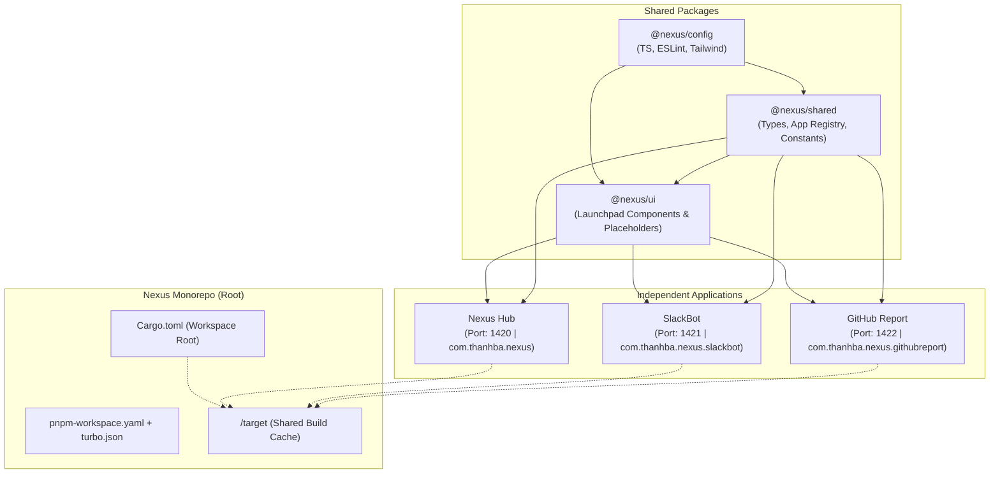
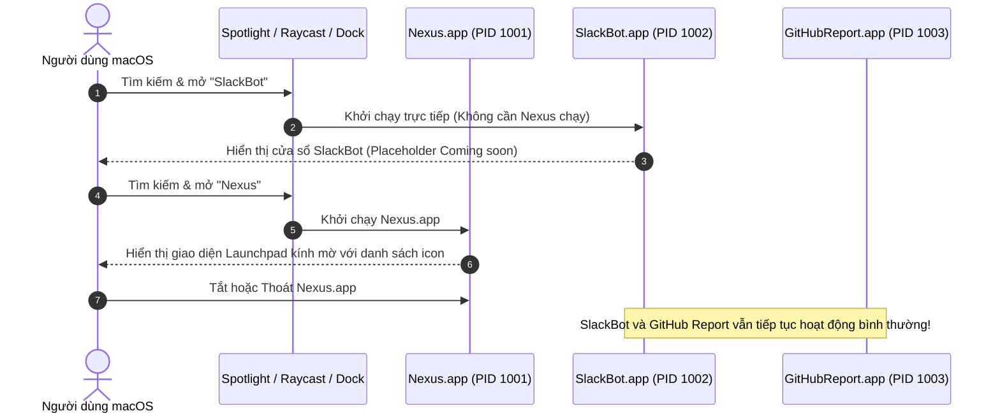

# Kiến Trúc Kỹ Thuật Hệ Thống Nexus Monorepo & Tauri v2 Multi-App

> **Tài liệu**: Kiến trúc tổng thể hệ thống (System Architecture Specification)  
> **Dự án**: Nexus Workspace  
> **Nền tảng mục tiêu**: macOS (hỗ trợ Apple Silicon M1/M2/M3/M4 & Intel x86_64)  
> **Công nghệ chủ đạo**: Tauri v2, Rust 2021, React, TypeScript, Tailwind CSS, Vite, pnpm workspace, Turborepo, Cargo Workspace.

---

## 1. Thẩm Định & Đánh Giá Định Hướng Công Nghệ ("Hướng làm có OK không?")

### 1.1. Kết luận thẩm định

**Định hướng kiến trúc của bạn là RẤT TỐT, CHUẨN MỰC VÀ TỐI ƯU VƯỢT TRỘI.**

Việc xây dựng hệ sinh thái **Nexus** dưới dạng một **Monorepo đa ứng dụng (Multi-App)** sử dụng **Tauri v2 + React + TypeScript + pnpm Workspaces + Turborepo + Cargo Workspace** là lựa chọn kiến trúc chuẩn mực nhất hiện nay cho hệ sinh thái desktop app trên macOS.

### 1.2. Phân tích so sánh chuyên sâu: Tauri v2 vs Electron

| Tiêu chí                                  | Tauri v2 (Nexus)                                                | Electron                                                        | Đánh giá & Tác động thực tế                                                                                                   |
| :---------------------------------------- | :-------------------------------------------------------------- | :-------------------------------------------------------------- | :---------------------------------------------------------------------------------------------------------------------------- |
| **Cơ chế Webview**                        | Tận dụng native **WKWebView** có sẵn của macOS                  | Đóng gói kèm toàn bộ **Chromium engine** (~150MB+)              | Tauri không cần tải engine trùng lặp với OS.                                                                                  |
| **Mức tiêu thụ RAM**                      | **~30MB - 50MB** / app                                          | **~250MB - 500MB+** / app                                       | Khi chạy đồng thời cả 3 apps (Nexus + SlackBot + GitHub Report), Tauri chỉ tốn ~120MB RAM, trong khi Electron ngốn > 1GB RAM. |
| **Kích thước file cài đặt (.dmg / .app)** | **~10MB - 15MB**                                                | **~120MB - 200MB+**                                             | Tiết kiệm hơn 85-90% dung lượng phân phối và lưu trữ trên ổ đĩa.                                                              |
| **Tốc độ khởi động (Cold Start)**         | **~0.2s - 0.4s** (gần như tức thì)                              | **~1.5s - 3.0s** (trễ đáng kể)                                  | Trải nghiệm native mượt mà chuẩn macOS.                                                                                       |
| **Mô hình bảo mật**                       | **Tauri 2 Capability & Permission System** hạt nhân             | Node.js integration (tiềm ẩn nguy cơ bảo mật nếu cấu hình lỏng) | Phân quyền từng lệnh IPC; chặn hoàn toàn các API không được khai báo.                                                         |
| **Backend Logic**                         | **Rust** (memory-safe, concurrency cao, zero-cost abstractions) | **Node.js** (single-threaded event loop, runtime V8)            | Tối ưu hóa CPU cho các tác vụ chạy nền của mini apps.                                                                         |

### 1.3. Khả năng chạy độc lập tuyệt đối (Independent Lifecycle)

- Mỗi ứng dụng trong `apps/` là một macOS Application Bundle (`.app`) độc lập, có Process ID (PID) riêng, App Bundle Identifier riêng (`com.thanhba.nexus`, `com.thanhba.nexus.slackbot`, `com.thanhba.nexus.githubreport`), icon riêng và entry point riêng.
- Người dùng có thể khởi chạy bất kỳ app nào trực tiếp từ Dock, Spotlight, Finder hoặc Raycast mà không yêu cầu Nexus phải chạy trước.
- Đóng Nexus hoàn toàn không ảnh hưởng đến SlackBot hay GitHub Report.

---

## 2. Thiết Kế Giao Diện Nexus Hub: macOS Launchpad & Frosted Glass

Theo thiết kế giao diện mẫu (tham chiếu hình ảnh thực tế từ người dùng), Nexus Hub đóng vai trò là một **Launchpad / App Grid** cao cấp trên macOS với hiệu ứng nền kính mờ trong suốt (Frosted Acrylic Blur / Translucent Vibrancy):

```
+-----------------------------------------------------------------------------------+
|  [Grid] [Search]                                              [Folder] [Settings] |  <- LaunchpadHeader
+-----------------------------------------------------------------------------------+
|                                                                                   |
|    (■)      (■)      (■)      (■)      (■)      (■)      (■)      (■)      (■)   |
|   Codex    Xcode   ChatGPT    Zed    Chrome   SlackBot  GH-Report Spark   OpenCode|
|                                                                                   |
|    (■)      (■)      (■)      (■)      (■)      (■)      (■)      (■)      (■)   |  <- AppGrid
|   VSCode   Figma   Tailscale Reminders Calendar AppStore Utils   Notion    Finder |     (Squircle icons +
|                                                                                   |      labels)
|    (■)      (■)      (■)      (■)      (■)      (■)      (■)      (■)      (■)   |
|   Safari  Music    Shortcuts CapCut   Alacritty Freeform Maps     Mail     Chess  |
|                                                                                   |
+-----------------------------------------------------------------------------------+
|                     [ (All)  (Dev)  (Chat)  (Game)  (+) ]             (Power)     |  <- LaunchpadFooter
+-----------------------------------------------------------------------------------+
```

### 2.1. Cấu hình Cửa Sổ Trong Suốt & macOS Vibrancy (Tauri 2)

1. **Cấu hình `tauri.conf.json` (`apps/nexus/src-tauri/tauri.conf.json`)**:
   - `macOSPrivateApi: true`: Mở quyền áp dụng `NSVisualEffectView`.
   - `transparent: true`: Cho phép webview render nền trong suốt xuyên thấu cửa sổ.
   - `decorations: false`: Tạo cửa sổ tràn viền (Frameless Launchpad) chuẩn macOS.
   - `shadow: true`: Giữ đổ bóng native của cửa sổ macOS.
2. **Kích hoạt Vibrancy trong Rust Backend (`src-tauri/src/lib.rs`)**:
   - Sử dụng crate `window-vibrancy`:
     ```rust
     use window_vibrancy::{apply_vibrancy, NSVisualEffectMaterial};

     apply_vibrancy(&window, NSVisualEffectMaterial::FullScreenUI, None, None)
         .expect("Vibrancy is only supported on macOS");
     ```
3. **Lớp Phủ CSS Frontend (Kính Mờ Trong Suốt)**:
   - Root HTML/Body: `background-color: transparent !important`.
   - Lớp vỏ ứng dụng: `bg-slate-950/40 backdrop-blur-2xl border border-white/10 rounded-2xl shadow-2xl`.

### 2.2. Kiến Trúc Bộ Component Giao Diện Launchpad (`@nexus/ui`)

Tất cả các thành phần UI của Launchpad được đóng gói thành các component độc lập tại `packages/ui`:

- **`LaunchpadLayout`**: Container chính điều phối bố cục 3 tầng (Header, Body, Footer), hỗ trợ phím tắt ESC và click ngoài để thu nhỏ.
- **`LaunchpadHeader`**: Thanh công cụ phía trên chứa icon chuyển đổi chế độ xem (Grid), ô tìm kiếm (Search), thư mục (Folder) và cài đặt (Settings).
- **`AppGrid`**: Lưới responsive hiển thị các mini app dạng squircle icons (SlackBot, GitHub Report và các slot placeholder).
- **`AppIconItem`**: Icon squircle macOS (`rounded-[22px]`, tỉ lệ vàng Apple), đổ bóng mềm, hiệu ứng hover phóng to nhẹ (`hover:scale-105`), nhãn chữ trắng sắc nét bên dưới.
- **`LaunchpadFooter`**: Thanh Floating Dock danh mục ở giữa (`All`, `Dev`, `Chat`, `Games`, `+`) và nút nguồn/thoát ở góc phải.

---

## 3. Kiến Trúc Monorepo: pnpm Workspace + Turborepo

Hệ thống được tổ chức theo mô hình **Component-driven Monorepo** để chia sẻ tối đa mã nguồn giữa các ứng dụng nhưng vẫn đảm bảo tính độc lập runtime:

```text
nexus/
├── apps/
│   ├── nexus/               # App trung tâm: Nexus Hub (Launchpad macOS)
│   ├── slackbot/            # Mini App 1: SlackBot
│   └── github-report/       # Mini App 2: GitHub Report
├── packages/
│   ├── config/              # Shared ESLint, TypeScript, Tailwind presets
│   ├── shared/              # Shared types, Enums, App metadata, constants
│   └── ui/                  # Shared React component library (Launchpad & Placeholders)
├── tooling/
│   └── scripts/             # Scripts hỗ trợ (check-env.sh, generate-icons.sh)
├── docs/                    # Tài liệu kiến trúc và quy chuẩn phát triển
│   ├── architecture.md      # Tài liệu này
│   ├── coding-standards.md  # Quy chuẩn code, style, naming, env, Rust
│   ├── implementation-plan.md # Lộ trình triển khai 6 Phase
│   └── prerequisites.md     # Hướng dẫn thiết lập môi trường macOS
├── Cargo.toml               # Cargo Workspace root chia sẻ build cache target/
├── pnpm-workspace.yaml      # Khai báo pnpm packages/apps
├── turbo.json               # Cấu hình Turborepo pipeline cache & build
├── package.json             # Root dependencies & package scripts
├── .gitignore
├── .editorconfig
├── .nvmrc
└── README.md
```

---

## 4. Kiến Trúc Cargo Workspace Tại Root (Tối Ưu Build Cache & Tránh Phình Ổ Cứng)

### 4.1. Vấn đề của mô hình Tauri truyền thống

Mặc định, nếu mỗi app trong `apps/` duy trì thư mục `src-tauri/target/` riêng rẽ:

- Khi biên dịch 3 app độc lập, trình biên dịch `rustc` sẽ tải và build các crate phụ thuộc (`tauri`, `tokio`, `serde`, `wry`, `cocoa`, ...) **3 lần riêng biệt**.
- Mỗi thư mục `target/` tốn từ 3GB đến 5GB dung lượng. Với 3 app, dung lượng đĩa bị chiếm dụng lên tới **10GB - 15GB**, đồng thời thời gian compile lần đầu tăng gấp 3 lần (lên đến 15-20 phút).

### 4.2. Giải pháp Cargo Workspace Root

Nexus áp dụng cấu hình **Cargo Workspace đặt tại root repository**:

```toml
# File: /Cargo.toml
[workspace]
resolver = "2"
members = [
    "apps/nexus/src-tauri",
    "apps/slackbot/src-tauri",
    "apps/github-report/src-tauri"
]

[workspace.dependencies]
tauri = { version = "2.0", features = [] }
tauri-build = { version = "2.0", features = [] }
tauri-plugin-opener = "2.0"
serde = { version = "1.0", features = ["derive"] }
serde_json = "1.0"
window-vibrancy = "0.5"

[profile.dev]
incremental = true
opt-level = 0

[profile.release]
opt-level = 3
lto = true
codegen-units = 1
panic = "abort"
strip = true
```

### 4.3. Lợi ích kỹ thuật đạt được:

1. **Chia sẻ chung 1 thư mục build cache**: Toàn bộ artifacts và intermediate crates chỉ nằm trong một thư mục duy nhất `/target/` tại root.
2. **Tiết kiệm 65-70% dung lượng đĩa**: Tổng dung lượng cache sau khi build 3 app chỉ còn ~3.5GB - 4.5GB (thay vì 15GB).
3. **Compile siêu tốc**: Các crate cơ sở như `tauri`, `serde`, `tokio` chỉ compile một lần duy nhất và tái sử dụng cho cả 3 ứng dụng.

---

## 5. Kiến Trúc 3 Ứng Dụng Độc Lập

Mỗi ứng dụng là một binary độc lập hoàn chỉnh, sở hữu Bundle ID, cổng phát triển (Vite Dev Port) riêng biệt và cấu hình bảo mật Tauri v2 phân lập:

| Ứng dụng                                 | Tên hiển thị    | Bundle ID                        | Port Dev | StrictPort | Mô tả hiển thị (Placeholder)                             |
| :--------------------------------------- | :-------------- | :------------------------------- | :------: | :--------: | :------------------------------------------------------- |
| **Nexus Hub** (`apps/nexus`)             | `Nexus`         | `com.thanhba.nexus`              |  `1420`  |   `true`   | Launchpad mờ trong suốt, App Grid, Header & Footer icons |
| **SlackBot** (`apps/slackbot`)           | `SlackBot`      | `com.thanhba.nexus.slackbot`     |  `1421`  |   `true`   | `SlackBot` — `Coming soon`                               |
| **GitHub Report** (`apps/github-report`) | `GitHub Report` | `com.thanhba.nexus.githubreport` |  `1422`  |   `true`   | `GitHub Report` — `Coming soon`                          |

---

## 6. Kiến Trúc Lưu Trữ Dữ Liệu Người Dùng (Local-First & macOS Keychain Storage)

Hệ thống Nexus hoạt động theo triết lý **Local-First**: Mọi cấu hình, cài đặt cá nhân và token nhạy cảm đều được lưu trữ trực tiếp trên máy Mac của người dùng, không phụ thuộc vào máy chủ trung gian và hoàn toàn riêng tư.

### 6.1. Phân Loại Dữ Liệu & Vị Trí Lưu Trữ Native macOS

```
+---------------------------------------------------------------------------------------+
|                                    MÁY MAC NGƯỜI DÙNG                                 |
+---------------------------------------------------------------------------------------+
|  [ Nhóm 1: Token & Bí Mật Nhạy Cảm ]        |  [ Nhóm 2: Cài Đặt & Trạng Thái Ứng Dụng ]|
|  - GitHub Personal Access Token (PAT)      |  - Theme (Dark/Light), Window Size       |
|  - Slack Bot Token / Webhook Secret         |  - Tần suất polling, Danh mục app ghim   |
|  - API Keys (OpenAI, Claude,...)            |  - Danh sách kênh Slack đã chọn         |
|  -----------------------------------------  |  --------------------------------------- |
|  NƠI LƯU: macOS Keychain                   |  NƠI LƯU: ~/Library/Application Support/ |
|  CÔNG NGHỆ: Crate Rust `keyring`            |  CÔNG NGHỆ: `tauri-plugin-store` (JSON)  |
|  BẢO MẬT: Apple Secure Enclave & OS Key    |  BẢO MẬT: Phân vùng chuẩn Apple macOS   |
+---------------------------------------------------------------------------------------+
```

### 6.2. Cấu Trúc Phân Vùng Lưu Trữ Trên macOS

Mỗi ứng dụng độc lập sở hữu thư mục dữ liệu chuẩn và service keychain riêng:

```text
/Users/<username>/Library/Application Support/
├── com.thanhba.nexus/                  # App Nexus Hub
│   └── settings.json                   # Theme, category lọc, danh sách app ghim
├── com.thanhba.nexus.slackbot/         # App SlackBot
│   └── settings.json                   # Cấu hình kênh gửi, template tin nhắn
└── com.thanhba.nexus.githubreport/     # App GitHub Report
    └── settings.json                   # Cấu hình danh sách repo theo dõi, bộ lọc PR
```

- **Quy tắc an ninh**:
  - Token người dùng không bao giờ ghi xuống file `.json` hoặc file văn bản thô.
  - Người dùng nhập token trên giao diện UI -> Gửi qua Tauri IPC -> Rust lưu an toàn vào macOS Keychain bằng `keyring::Entry`.

---

## 7. Sơ Đồ Kiến Trúc Hệ Thống (Mermaid Diagrams)

### 7.1. Sơ đồ Cấu trúc Monorepo & Phụ thuộc



### 7.2. Sơ đồ Độc Lập Vòng Đời Ứng Dụng (Independent Lifecycle)


