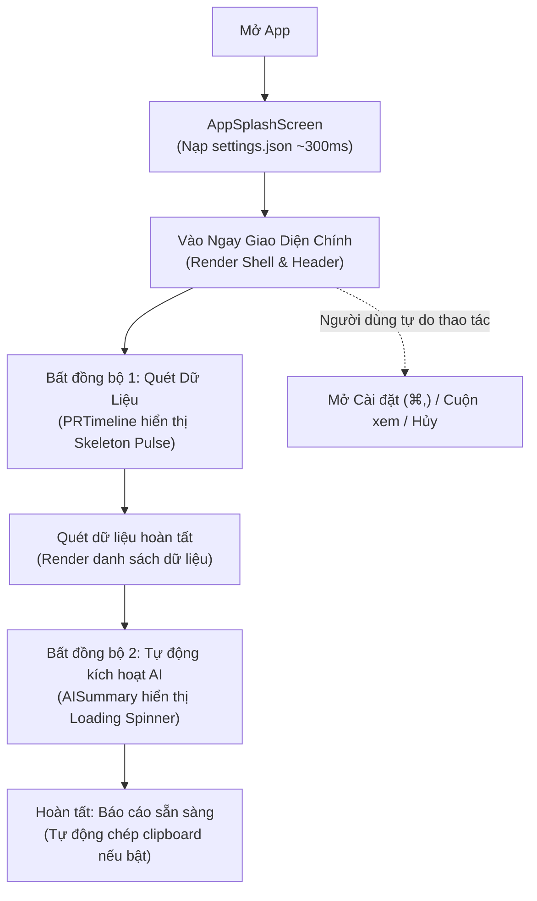

# Quy Chuẩn Lập Trình & Tiêu Chuẩn Kỹ Thuật (Coding Standards)

> **Tài liệu**: Quy chuẩn phát triển mã nguồn toàn dự án (Engineering Coding Standards & Guidelines)  
> **Dự án**: Nexus Workspace  
> **Áp dụng cho**: Toàn bộ lập trình viên, subagents và automated pipelines  
> **Phiên bản**: v1.0.0  
> **Trạng thái**: Hiệu lực bắt buộc (Mandatory)

---

## 1. Định Dạng Mã Nguồn, Linter & Style Guides

### 1.1. Cấu hình Prettier (`.prettierrc.json`)

Toàn bộ mã nguồn (TypeScript, JavaScript, JSON, CSS, Markdown) trong monorepo phải tuân theo cấu hình Prettier chung tại root:

```json
{
  "semi": true,
  "singleQuote": true,
  "trailingComma": "all",
  "tabWidth": 2,
  "printWidth": 100,
  "bracketSpacing": true,
  "arrowParens": "always",
  "endOfLine": "lf"
}
```

### 1.2. ESLint Flat Config (`eslint.config.js`)

- Áp dụng cấu hình ESLint 9 Flat Config tại root và kế thừa qua các packages/apps.
- **Cấm triệt để kiểu dữ liệu `any`**: Bật `@typescript-eslint/no-explicit-any: error`. Nếu bắt buộc phải xử lý dữ liệu chưa rõ kiểu (ví dụ payload từ IPC hoặc webhook), phải sử dụng `unknown` và kiểm tra type guard bằng Zod hoặc TypeScript type predicates.
- **Không cho phép biến không sử dụng**: Cấu hình cảnh báo biến chưa dùng với ngoại lệ tiền tố gạch dưới `_` (`argsIgnorePattern: "^_"`).

### 1.3. TypeScript Strict Mode

Tất cả các project trong `apps/` và `packages/` bắt buộc phải kế thừa cấu hình từ `packages/config/tsconfig.base.json`:

```json
{
  "compilerOptions": {
    "target": "ES2022",
    "module": "NodeNext",
    "moduleResolution": "NodeNext",
    "strict": true,
    "noImplicitAny": true,
    "strictNullChecks": true,
    "noUncheckedIndexedAccess": true,
    "exactOptionalPropertyTypes": true,
    "skipLibCheck": true,
    "isolatedModules": true
  }
}
```

---

## 2. Quy Ước Cấu Trúc Thư Mục & Đặt Tên File

```text
nexus/
├── apps/
│   ├── [app-name]/                  # kebab-case (ví dụ: nexus, slackbot, github-report)
│   │   ├── src/
│   │   │   ├── components/          # PascalCase cho file component (ví dụ: LaunchpadGrid.tsx)
│   │   │   ├── hooks/               # kebab-case bắt đầu bằng use- (ví dụ: use-app-launcher.ts)
│   │   │   ├── utils/               # kebab-case (ví dụ: format-date.ts)
│   │   │   ├── types/               # kebab-case (ví dụ: app-state.ts)
│   │   │   ├── env.ts               # File validate biến môi trường runtime
│   │   │   ├── App.tsx
│   │   │   └── main.tsx
│   │   ├── src-tauri/               # Thư mục backend Rust của Tauri
│   │   ├── .env.example             # Bắt buộc commit vào git
│   │   ├── .env                     # Bắt buộc nằm trong .gitignore
│   │   ├── vite.config.ts
│   │   └── package.json
├── packages/
│   ├── config/                      # @nexus/config
│   ├── shared/                      # @nexus/shared
│   └── ui/                          # @nexus/ui
├── tooling/
│   └── scripts/                     # kebab-case cho shell scripts (check-env.sh, generate-icons.sh)
└── docs/                            # kebab-case cho tài liệu (architecture.md, coding-standards.md)
```

### Quy tắc đặt tên file:

1. **React Components**: `PascalCase.tsx` (ví dụ: `LaunchpadLayout.tsx`, `AppIconItem.tsx`).
2. **React Hooks**: `use-[feature-name].ts` (ví dụ: `use-app-launcher.ts`, `use-window-size.ts`).
3. **Modules / Utilities / Helpers**: `kebab-case.ts` (ví dụ: `app-registry.ts`, `ipc-client.ts`).
4. **CSS Files**: `kebab-case.css` (ví dụ: `base.css`, `index.css`).
5. **Shell Scripts**: `kebab-case.sh` (ví dụ: `check-env.sh`, `generate-icons.sh`).

---

## 3. Quy Chuẩn Đặt Tên Mã Nguồn (Naming Conventions)

### 3.1. Components & Props

- Tên Component: `PascalCase` (danh từ hoặc cụm danh từ mô tả đúng giao diện).
- Tên Props Interface: `[ComponentName]Props` (ví dụ: `LaunchpadHeaderProps`, `AppIconItemProps`).
- **Tuyệt đối KHÔNG sử dụng tiền tố `I`** cho Interface (dùng `AppMeta`, KHÔNG dùng `IAppMeta`).

```typescript
// ✅ ĐÚNG:
export interface AppIconItemProps {
  app: NexusAppMeta;
  isSelected?: boolean;
  onLaunch: (appId: string) => void;
}

export function AppIconItem({ app, isSelected = false, onLaunch }: AppIconItemProps) {
  // ...
}

// ❌ SAI:
export interface IAppIconItemProps { ... }
export const app_icon_item = () => { ... }
```

### 3.2. Custom Hooks

- Luôn bắt đầu bằng từ khóa `use` dạng `camelCase` (ví dụ: `useAppLauncher`, `useFrostedVibrancy`).
- Giá trị trả về phải là một Object được định kiểu rõ ràng hoặc một tuple có `as const`.

### 3.3. Định Danh Ứng Dụng (AppId Enum) & String Literal Union Types

- **Bắt buộc dùng `enum AppId` cho định danh ứng dụng**: Để tránh hoàn toàn việc viết các mảng chuỗi ma thuật (magic strings) như `['slackbot', 'github-report']` rải rác trong mã nguồn, toàn bộ hệ thống Nexus bắt buộc phải sử dụng `enum AppId` tập trung:

  ```typescript
  // ✅ ĐÚNG: Định danh app bằng Enum tập trung
  export enum AppId {
    NEXUS = 'nexus',
    SLACKBOT = 'slackbot',
    GITHUB_REPORT = 'github-report',
  }

  // Khai báo mảng mặc định an toàn:
  export const DEFAULT_INSTALLED_APP_IDS: readonly AppId[] = [AppId.SLACKBOT, AppId.GITHUB_REPORT];
  ```

- **Đối với Danh mục (Categories) & Trạng thái phân loại (Status)**: Sử dụng `as const` Object kết hợp String Literal Union Type (`AppCategory`, `AppStatus`) để đảm bảo Zero Runtime Overhead và tương thích trực tiếp 1:1 với Rust Serde payload.

```typescript
// ✅ ĐÚNG CHUẨN NEXUS:
export const APP_CATEGORY = {
  ALL: 'all',
  DEV: 'dev',
  CHAT: 'chat',
  GAMES: 'games',
  UTILITIES: 'utilities',
} as const;

export type AppCategory = (typeof APP_CATEGORY)[keyof typeof APP_CATEGORY];

export const APP_STATUS = {
  READY: 'ready',
  COMING_SOON: 'coming-soon',
  MAINTENANCE: 'maintenance',
} as const;

export type AppStatus = (typeof APP_STATUS)[keyof typeof APP_STATUS];
```

### 3.4. Biến (Variables), Hàm (Functions) & Quy tắc Tiền Tố Boolean

- Tên biến & hàm: `camelCase`.
- **Biến Boolean bắt buộc phải có tiền tố thể hiện câu hỏi điều kiện**:
  - `is*`: `isReady`, `isVisible`, `isHovered`, `isTranslucent`, `isRunning`, `isUpdating`
  - `has*`: `hasNotification`, `hasUpdate`, `hasError`
  - `can*`: `canLaunch`, `canMinimize`, `canDrag`
  - `should*`: `shouldAutoLaunch`, `shouldCloseOnSelect`
- **Quy tắc Event Handlers**:
  - Hàm xử lý sự kiện nội bộ: Tiền tố `handle*` (ví dụ: `handleAppClick`, `handleSearchChange`, `handleKeyDown`).
  - Callback props truyền từ ngoài vào: Tiền tố `on*` (ví dụ: `onAppLaunch`, `onFilterChange`, `onClose`).

### 3.5. Hằng Số (Constants)

- **Hằng số toàn cục** (Global Configuration Constants): `UPPER_SNAKE_CASE` (ví dụ: `DEFAULT_PORT`, `MAX_RECENT_APPS`, `MACOS_BUNDLE_PREFIX`).
- **Hằng số cục bộ trong hàm**: `camelCase` (ví dụ: `const matchedApps = ...`).

### 3.6. Quy Chuẩn Hạn Chế Tối Đa `useEffect` (You Might Not Need an Effect)

Theo triết lý React hiện đại, `useEffect` là "cửa thoát hiểm" (escape hatch) để đồng bộ với các hệ thống bên ngoài trình duyệt, **KHÔNG PHẢI** công cụ để điều khiển luồng dữ liệu state nội bộ. Việc lạm dụng `useEffect` gây ra lỗi re-render dư thừa, chuyển dịch bố cục ngoài ý muốn (layout shift), và làm phức tạp hóa vòng đời dữ liệu.

#### 5 Nguyên Tắc Bắt Buộc Về `useEffect`:

1. **Tuyệt đối KHÔNG dùng `useEffect` để tính toán dữ liệu phái sinh (Derived State)**:
   - Nếu một giá trị có thể tính toán được từ `props` hoặc `state` hiện có, hãy tính trực tiếp trong quá trình render hoặc dùng `useMemo`.
   - ❌ **Sai**: Dùng `useEffect` lắng nghe `apps` để tính `filteredApps` rồi `setFilteredApps`.
   - ✅ **Đúng**: `const filteredApps = useMemo(() => apps.filter(...), [apps, search]);`

2. **Tuyệt đối KHÔNG dùng `useEffect` để xử lý sự kiện người dùng (User Events)**:
   - Khi người dùng click nút, đóng mở menu, hoặc thao tác chuột, toàn bộ logic cập nhật state và hành động phụ phải nằm ngay trong **Event Handler** (`onClick`, `onSubmit`, `onContextMenu`).
   - ❌ **Sai**: Bấm nút -> `setIsDeleting(true)` -> `useEffect` lắng nghe `isDeleting` để thực hiện xóa.
   - ✅ **Đúng**: Bấm nút -> gọi thẳng hàm `handleDeleteApp(appId)`.

3. **Tuyệt đối KHÔNG dùng `useEffect` để đồng bộ State vào Storage (`localStorage` / `tauri-plugin-store`)**:
   - Việc ghi dữ liệu vào storage phải được thực hiện trực tiếp bên trong hàm updater hoặc event handler gây ra sự thay đổi đó.
   - ❌ **Sai**: Tạo `useEffect(() => localStorage.setItem('apps', ids), [ids])`.
   - ✅ **Đúng**: Đóng gói trong hàm updater:
     ```typescript
     const updateInstalledAppIds = (updater: (prev: AppId[]) => AppId[]) => {
       setInstalledAppIds((prev) => {
         const next = updater(prev);
         localStorage.setItem(LOCAL_STORAGE_KEY, JSON.stringify(next));
         return next;
       });
     };
     ```

4. **Khởi tạo State dùng Lazy Initializer thay vì `useEffect`**:
   - Đọc dữ liệu từ `localStorage` hoặc cấu hình ban đầu phải truyền qua hàm callback trong `useState`:
   - ❌ **Sai**: `const [data, setData] = useState(null); useEffect(() => setData(readFromStorage()), []);` (gây double render và layout shift).
   - ✅ **Đúng**: `const [data, setData] = useState(() => readFromStorage() || defaultValue);`

5. **Trường hợp DUY NHẤT được phép sử dụng `useEffect`**:
   - Khi thực sự cần kết nối hoặc đồng bộ với **External Systems** (hệ thống bên ngoài vòng đời React):
     - Lắng nghe sự kiện toàn cục của window/document (`keydown` cho phím Esc, `mousedown` cho click outside) **bắt buộc phải có cleanup function**.
     - Thiết lập WebSocket, EventSource, hoặc IPC streaming từ Tauri Rust backend.

---

## 4. Quản Lý Biến Môi Trường (.env, .env.example)

### 4.1. Phân Tách Phạm Vi Biến Môi Trường

- **Biến Frontend (`VITE_*`)**:
  - Vite chỉ nạp và đóng gói các biến có tiền tố `VITE_` vào bundle client (`import.meta.env.VITE_*`).
  - **CẢNH BÁO AN NINH**: Tuyệt đối KHÔNG lưu secret keys, private API tokens, private webhook secrets vào các biến có tiền tố `VITE_` vì chúng sẽ bị lộ công khai trong mã nguồn client.
- **Biến Backend Rust / Build Time**:
  - Các biến không có tiền tố `VITE_` chỉ được đọc trong scripts Node.js hoặc backend Rust.

### 4.2. Chuẩn Hóa Cấu Trúc File `.env` & `.env.example`

Mỗi ứng dụng (`apps/nexus`, `apps/slackbot`, `apps/github-report`) đều phải duy trì cặp file:

#### 1. File mẫu commit lên git: `.env.example`

```bash
# ==============================================================================
# Nexus Hub Configuration Template
# ==============================================================================
VITE_APP_TITLE="Nexus"
VITE_APP_PORT=1420
VITE_ENABLE_VIBRANCY=true
VITE_DEFAULT_CATEGORY="all"
VITE_LOG_LEVEL="debug"
```

#### 2. File cấu hình thực tế: `.env`

- Chứa giá trị thực tế của developer trên máy local.
- **BẮT BUỘC nằm trong file `.gitignore` root**. Tuyệt đối không bao giờ commit `.env` lên Git repo.

### 4.3. Xác Thực Biến Môi Trường Khi Runtime (Runtime Validation)

Để ngăn chặn lỗi ứng dụng chạy ngầm do thiếu hoặc sai cấu hình biến môi trường, mỗi app phải xây dựng file `src/env.ts` sử dụng **Zod**:

```typescript
import { z } from 'zod';

const envSchema = z.object({
  VITE_APP_TITLE: z.string().min(1).default('Nexus'),
  VITE_APP_PORT: z.coerce.number().default(1420),
  VITE_ENABLE_VIBRANCY: z
    .string()
    .transform((val) => val === 'true')
    .default('true'),
  VITE_DEFAULT_CATEGORY: z.enum(['all', 'dev-tools', 'messaging', 'games']).default('all'),
  VITE_LOG_LEVEL: z.enum(['debug', 'info', 'warn', 'error']).default('info'),
});

export const env = envSchema.parse(import.meta.env);
```

---

## 5. Lưu Trữ Dữ Liệu Cục Bộ & Bảo Mật Token Trên macOS

### 5.1. Phân Định Giữa Môi Trường Dev (.env) và Bản Release Của Người Dùng

- **Bản Release Cho Người Dùng Cuối**:
  - Người dùng tải bản release (`.app` / `.dmg`) về máy **hoàn toàn KHÔNG CẦN và KHÔNG DÙNG file `.env`**.
  - Người dùng cấu hình tài khoản, nhập token trực tiếp trên form giao diện (UI). Dữ liệu được app tự động lưu trên máy cục bộ của người đó (Local-First).
- **Môi Trường Phát Triển Của Developer**:
  - File `.env` / `.env.example` **CHỈ phục vụ cho lập trình viên** lúc code cục bộ để cấu hình cổng dev (`VITE_APP_PORT`), bật/tắt debug logs (`VITE_LOG_LEVEL`) hoặc cờ tính năng thử nghiệm.

### 5.2. Lưu Trữ Cài Đặt Thông Thường (Settings, Preferences, UI State)

- **Công nghệ chuẩn**: Sử dụng **`tauri-plugin-store`** (plugin chính thức từ Tauri Team).
- **Vị trí lưu trữ native trên macOS**:
  Tự động lưu vào file JSON tại thư mục chuẩn của hệ điều hành:  
  `~/Library/Application Support/<bundle-id>/settings.json`
- **Ví dụ phân vùng cho 3 apps**:
  - Nexus: `~/Library/Application Support/com.thanhba.nexus/settings.json`
  - SlackBot: `~/Library/Application Support/com.thanhba.nexus.slackbot/settings.json`
  - GitHub Report: `~/Library/Application Support/com.thanhba.nexus.githubreport/settings.json`
- **Mã nguồn mẫu sử dụng trong TypeScript**:
  ```typescript
  import { LazyStore } from '@tauri-apps/plugin-store';

  const store = new LazyStore('settings.json');

  // Lưu cấu hình người dùng
  await store.set('theme', 'dark');
  await store.set('refreshIntervalMinutes', 15);
  await store.save();

  // Đọc cấu hình
  const theme = await store.get<string>('theme');
  ```
- **Lưu ý**: Tuyệt đối **không sử dụng `localStorage`** của trình duyệt làm nơi lưu trữ chính vì WebKit có thể dọn cache hoặc reset bất ngờ khi nâng cấp hệ điều hành, đồng thời backend Rust không truy cập trực tiếp được.

### 5.3. Lưu Trữ Token & Bí Mật Nhạy Cảm (Secrets, Tokens, Passwords)

- **Công nghệ chuẩn**: Sử dụng **macOS Keychain** (Hệ thống Móc Khóa macOS) thông qua crate Rust **`keyring`**.
- **Mục tiêu bảo mật**:
  - Không bao giờ lưu token thô (plain-text) ra file JSON hoặc ổ đĩa.
  - Tận dụng bảo mật phần cứng Apple Secure Enclave trên chip Apple Silicon và mã hóa cấp hệ điều hành macOS.
- **Ví dụ áp dụng**:
  - GitHub Personal Access Token (PAT)
  - Slack Bot Token / Webhook Signing Secret
  - API Keys
- **Mã nguồn mẫu IPC trong Rust Backend**:
  ```rust
  use keyring::Entry;

  #[tauri::command]
  pub fn save_secure_secret(service: String, secret: String) -> Result<(), String> {
      let entry = Entry::new(&service, "nexus_user").map_err(|e| e.to_string())?;
      entry.set_password(&secret).map_err(|e| e.to_string())?;
      Ok(())
  }

  #[tauri::command]
  pub fn get_secure_secret(service: String) -> Result<String, String> {
      let entry = Entry::new(&service, "nexus_user").map_err(|e| e.to_string())?;
      entry.get_password().map_err(|e| e.to_string())
  }
  ```

### 5.4. Quy Chuẩn Phân Tách Môi Trường Dev & Prod (Environment Isolation Standard)

Để đảm bảo môi trường phát triển (Dev) không bao giờ làm bẩn, ghi đè hoặc xung đột dữ liệu cấu hình và token bảo mật với bản chính thức (Production), toàn bộ các ứng dụng trong hệ sinh thái Nexus **BẮT BUỘC** tuân thủ quy chuẩn phân tách 3 tầng:

| Tầng lưu trữ            | Môi trường Dev                                                 | Môi trường Prod                                        | Cơ chế kỹ thuật                                       |
| :---------------------- | :------------------------------------------------------------- | :----------------------------------------------------- | :---------------------------------------------------- |
| **App Bundle ID**       | `<bundle-id>.dev` _(vd: `com.thanhba.nexus.githubreport.dev`)_ | `<bundle-id>` _(vd: `com.thanhba.nexus.githubreport`)_ | Tauri CLI override `-c src-tauri/tauri.dev.conf.json` |
| **Application Support** | `~/Library/Application Support/<bundle-id>.dev/`               | `~/Library/Application Support/<bundle-id>/`           | Tự động phân tách theo Bundle ID của Tauri Store      |
| **macOS Keychain**      | Service: `<name>-dev`, Account: `nexus_user_dev`               | Service: `<name>`, Account: `nexus_user`               | Rust `cfg!(debug_assertions)` tự động định tuyến      |
| **Web Fallback**        | Key: `<name>_settings_dev`                                     | Key: `<name>_settings`                                 | Frontend `import.meta.env.DEV`                        |

#### 1. Cấu hình Tauri Bundle ID (`tauri.dev.conf.json`)

Mỗi app tạo thêm file `src-tauri/tauri.dev.conf.json` chỉ chứa thông tin override cho Dev:

```json
{
  "$schema": "https://schema.tauri.app/config/2",
  "productName": "GitHub Report (Dev)",
  "identifier": "com.thanhba.nexus.githubreport.dev"
}
```

Và cấu hình lệnh chạy dev trong `package.json`:

```json
"scripts": {
  "desktop": "tauri dev -c src-tauri/tauri.dev.conf.json",
  "desktop:build": "tauri build"
}
```

#### 2. Định tuyến macOS Keychain trong Rust Backend

Sử dụng macro `cfg!(debug_assertions)` để tự động chuyển Service và Account:

```rust
fn get_keychain_service(base: &str) -> String {
    if cfg!(debug_assertions) {
        format!("{}-dev", base)
    } else {
        base.to_string()
    }
}

fn get_keychain_account() -> &'static str {
    if cfg!(debug_assertions) {
        "nexus_user_dev"
    } else {
        "nexus_user"
    }
}
```

#### 3. Phân tách Web Fallback LocalStorage trong Frontend

```typescript
const LOCAL_STORAGE_KEY = import.meta.env.DEV
  ? 'nexus_github_report_settings_dev'
  : 'nexus_github_report_settings';
```

## 6. Quy Chuẩn Lập Trình Backend Rust & Tauri v2

### 6.1. Naming Conventions trong Rust

- Functions, methods, modules, local variables: `snake_case` (ví dụ: `launch_mini_app`, `check_bundle_status`).
- Structs, Enums, Traits: `PascalCase` (ví dụ: `AppRegistry`, `TauriCommandResponse`).
- Constants & Statics: `SCREAMING_SNAKE_CASE` (ví dụ: `DEFAULT_WINDOW_WIDTH`).

### 6.2. Quản Trị Lỗi (Error Handling & Robustness)

- **CẤM SỬ DỤNG `.unwrap()` hoặc `.expect()` TRONG RUNTIME CODE**:
  Việc gọi `.unwrap()` khi gặp lỗi sẽ làm panic và crash toàn bộ tiến trình desktop app của người dùng.
- Sử dụng mô hình `Result<T, E>` tường minh kết hợp crate `thiserror`:

```rust
use thiserror::Error;

#[derive(Debug, Error)]
pub enum AppError {
    #[error("Mini app with bundle ID '{0}' not found on macOS system")]
    AppNotFound(String),
    #[error("Failed to execute native launch command: {0}")]
    ProcessError(#[from] std::io::Error),
    #[error("Invalid capability permission: {0}")]
    PermissionDenied(String),
}

// Map sang Result<T, String> thân thiện khi trả về qua Tauri Command:
#[tauri::command]
pub fn launch_mini_app(bundle_id: String) -> Result<String, String> {
    internal_launch(&bundle_id).map_err(|err| err.to_string())
}
```

### 6.3. Bảo Mật Tauri v2 Capabilities

- Không bao giờ cấp quyền wildcard (`"*"`) trong file `capabilities/default.json`.
- Chỉ khai báo chính xác các lệnh IPC được phép gọi từ frontend webview tương ứng.

### 6.4. Bắt Buộc Sử Dụng Asynchronous IPC Commands Để Bảo Toàn Khả Năng Phản Hồi Của Giao Diện (Non-Blocking IPC)

Khi thực thi các tác vụ tốn thời gian trong Rust backend (chạy process CLI ngoài qua `Command`, gọi AppleScript `osascript`, truy vấn I/O ổ đĩa hoặc HTTP network):

- **NGHIÊM CẤM** chạy các lệnh đồng bộ (`std::process::Command::output()`, `thread::sleep`, v.v.) trực tiếp trong luồng chính của Tauri command.
- **HẬU QUẢ NẾU LÀM SAI**: Tauri Command chạy trên luồng IPC xử lý sự kiện. Nếu luồng này bị chặn, macOS WindowServer sẽ nhận định ứng dụng "Application Not Responding", gây đóng băng cửa sổ và làm gián đoạn hoàn toàn tương tác của người dùng.
- **QUY TẮC BẮT BUỘC**:
  1. Hàm command phải là `pub async fn`.
  2. Bọc toàn bộ các tác vụ blocking bên trong `tauri::async_runtime::spawn_blocking(...)`.
  3. Xử lý song song bằng luồng worker nếu có nhiều tác vụ I/O độc lập (ví dụ `std::thread::scope`).

```rust
// ✅ ĐÚNG CHUẨN: Non-blocking Async Command
#[tauri::command]
pub async fn fetch_github_prs(since_iso: String) -> Result<Vec<PRReportItem>, String> {
    tauri::async_runtime::spawn_blocking(move || {
        // Thực thi shell Command::new("gh") an toàn ở background thread
        internal_fetch_prs(&since_iso)
    })
    .await
    .map_err(|e| format!("Task execution failed: {}", e))?
}

// ❌ SAI LẦM: Chặn luồng IPC gây khóa giao diện (Blocking Main/IPC Thread)
#[tauri::command]
pub fn fetch_github_prs(since_iso: String) -> Result<Vec<PRReportItem>, String> {
    // Luồng IPC bị treo cho đến khi lệnh `gh` chạy xong!
    std::process::Command::new("gh").arg("search").output()
}
```

---

## 7. Chuẩn Hóa Giao Diện & Vòng Đời Mini App (Mini App Architecture Standards)

> 📖 **Xem hướng dẫn chi tiết & checklist thực thi tại**: [`docs/mini-app-guide.md`](file:///Users/lethanhba/workspace/app/nexus/docs/mini-app-guide.md)

Tất cả các mini apps phát triển trong monorepo Nexus (như `apps/github-report`, `apps/slackbot`, v.v.) phải kế thừa các component dùng chung từ `@nexus/ui` và tuân theo nguyên tắc trải nghiệm người dùng tương tự Web Dashboard hiện đại:

### 7.1. Chuẩn Hóa Header Cửa Sổ (`MiniAppHeader` từ `@nexus/ui`)

Cửa sổ mini app trên macOS luôn sử dụng chế độ `titleBarStyle: "Overlay"` kết hợp với component `MiniAppHeader`:

1. **Khoảng cách an toàn Traffic Lights**: Header tự động chừa biên an toàn 76px (`leftSafeWidth={76}`) ở góc trên bên trái để 3 nút 🔴 🟡 🟢 của macOS không bị các nút tính năng đè lên.
2. **Kéo cửa sổ (Window Dragging)**:
   - Các vùng nền trống trên header được gắn `data-tauri-drag-region` để người dùng có thể nhấp chuột kéo cửa sổ linh hoạt.
   - Các nút bấm, icon, dropdown, input trên header bắt buộc phải có thuộc tính `data-no-drag` hoặc class `no-drag` để sự kiện click không bị nuốt bởi trình quản lý cửa sổ Tauri.
3. **Cấu trúc 3 vùng linh hoạt**:
   - `leftSlot`: Chứa App Icon, tiêu đề ứng dụng, filter dropdown hoặc status badge.
   - `centerSlot`: Chứa thanh tìm kiếm, tabs điều hướng hoặc thông tin tiến trình.
   - `rightSlot`: Chứa các nút thao tác chính (Refresh, Copy, Settings `⌘,`, v.v.).

```tsx
import { MiniAppHeader } from '@nexus/ui';

export function AppHeader() {
  return (
    <MiniAppHeader
      leftSafeWidth={76}
      leftSlot={<span className="text-xs font-semibold text-sky-400">GitHub Report</span>}
      rightSlot={
        <div className="flex items-center gap-1.5" data-no-drag>
          <button onClick={handleRefresh}>Làm mới (⌘R)</button>
        </div>
      }
    />
  );
}
```

### 7.2. Màn Hình Khởi Động Tối Giản (`AppSplashScreen` từ `@nexus/ui`)

- Màn hình khởi động chỉ xuất hiện trong tích tắc (~200ms đến 400ms) để tải các cấu hình nền tảng quan trọng (`settings.json`, kiểm tra CLI/Keychain).
- **Thiết kế tối giản**: Chỉ gồm Icon ứng dụng phát sáng (Glowing App Icon), tên app, số phiên bản và thanh tiến trình mượt mà (Progress bar).
- **Tuyệt đối KHÔNG chạy các tác vụ nặng** (như kéo commit, gọi mạng, sinh văn bản AI) trong màn hình khởi động vì sẽ làm người dùng có cảm giác ứng dụng khởi động chậm chạp.
- Chuyển tiếp mượt mà vào giao diện chính bằng animation fade-out (`opacity-0 pointer-events-none`).

### 7.3. Triết Lý Trải Nghiệm Bất Đồng Bộ Non-Blocking (Web-Dashboard Pattern)

Luồng hoạt động chuẩn của mọi mini app khi mở:



1. **Hiển thị tức thì (Instant Interface)**: Người dùng phải nhìn thấy cấu trúc giao diện làm việc ngay lập tức, không để màn hình trắng hoặc màn hình splash đơ cứng.
2. **Skeleton Loading cục bộ**: Khu vực nào đang tải dữ liệu thì hiển thị Skeleton/Spinner cục bộ ở đúng khu vực đó (ví dụ Skeleton tại PR Timeline, Spinner tại AI Summary Card).
3. **Không khóa tương tác**: Trong khi hệ thống đang quét dữ liệu hoặc AI đang xử lý, người dùng vẫn hoàn toàn tự do thao tác mở Modal Cài đặt (`⌘,`), xem danh sách, chỉnh sửa cấu hình với trải nghiệm mượt mà liên tục.

---

## 8. Tiêu Chí Kiểm Duyệt Pull Request (PR Review Checklist)

Mọi đóng góp mã nguồn mới bắt buộc phải thỏa mãn checklist sau trước khi được merge:

- [ ] Chạy `pnpm typecheck` thành công với 0 lỗi.
- [ ] Chạy `pnpm lint` thành công với 0 cảnh báo nghiêm trọng.
- [ ] Chạy `pnpm format` không có file bị sai quy chuẩn.
- [ ] Không có file `.env`, token, secret hoặc file rác trong commit.
- [ ] Biến môi trường mới (nếu có) đã được cập nhật tương ứng vào `.env.example` và `src/env.ts`.
- [ ] Token và secret nhạy cảm được lưu qua macOS Keychain (`keyring`), không lưu plain-text trong file json hay localStorage.
- [ ] Cài đặt người dùng được lưu qua `tauri-plugin-store` tại thư mục chuẩn `~/Library/Application Support/`.
- [ ] **Tuân thủ phân tách môi trường Dev & Prod**:
  - Có `tauri.dev.conf.json` định nghĩa bundle ID `.dev`.
  - Token trong macOS Keychain tự động chuyển sang `<service>-dev` và account `nexus_user_dev` khi chạy ở chế độ debug.
- [ ] Đặt tên đúng chuẩn (kebab-case cho files, PascalCase cho Components, `is/has/can/should` cho booleans).
- [ ] Không sử dụng `enum` số; đã dùng `as const` hoặc string literal unions.
- [ ] Code Rust không chứa `.unwrap()` ở runtime context.
- [ ] **Tác vụ nặng trong Rust (CLI, Network, AppleScript) bắt buộc dùng `async fn` + `tauri::async_runtime::spawn_blocking` để tránh chặn luồng IPC và bảo toàn khả năng phản hồi của giao diện**.
- [ ] **Mini Apps kế thừa `MiniAppHeader` và `AppSplashScreen` từ `@nexus/ui`, tuân thủ trải nghiệm tải dữ liệu bất đồng bộ non-blocking**.
