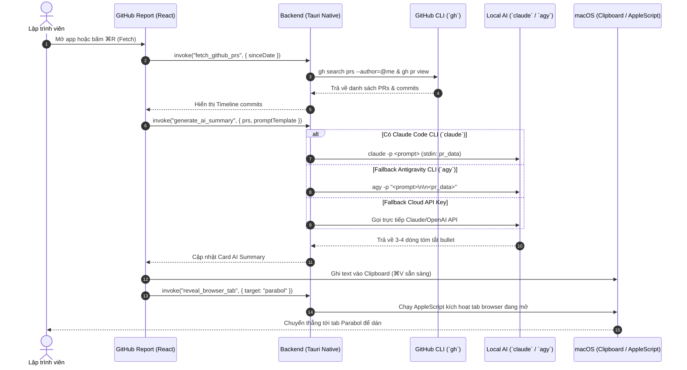

# 📊 GitHub Report - Tài Liệu Đặc Tả & Thiết Kế Kiến Trúc

> **GitHub Report** là ứng dụng độc lập trong hệ sinh thái **Nexus**, hỗ trợ lập trình viên tự động quét Pull Request & commit trên GitHub, tóm tắt nội dung Daily Standup bằng **Local AI (Zero-Token Cost)** và kích hoạt tab **Parabol / Slack / Notion** chỉ với một thao tác.

---

## 1. Tổng Quan & Triết Lý Sản Phẩm

Mỗi buổi sáng họp **Daily Standup** hoặc viết cập nhật trên **Parabol**, lập trình viên thường mất từ 5-15 phút để mở từng PR trên GitHub nhằm nhớ lại hôm qua mình đã hoàn thành những gì.

**GitHub Report** kế thừa và nâng cấp toàn diện từ dự án gốc `PR-report` với 4 giá trị cốt lõi:

1. **Zero-Token Cost (Local AI First)**: Ưu tiên dùng phiên đăng nhập CLI có sẵn trên máy Mac (`claude` Code CLI hoặc `agy` Antigravity CLI), không tốn tiền API token và không yêu cầu cấu hình phức tạp.
2. **Giao Diện Chuẩn macOS & Nexus Aesthetic**: Ngôn ngữ thiết kế Glassmorphism tối mờ (Dark Acrylic Vibrancy), điểm nhấn màu xanh Sky Blue `#0ea5e9`, bo góc squircle tinh tế.
3. **Unified Window Titlebar (Thanh Header Tuỳ Biến)**: Tích hợp 3 nút Traffic Lights gốc macOS (Đỏ 🔴, Vàng 🟡, Xanh 🟢) trực tiếp trên thanh công cụ đa năng của ứng dụng.
4. **Local-First & Bảo Mật Tuyệt Đối**: Cài đặt và Prompt lưu dạng JSON Key-Value Store (`tauri-plugin-store`), token nhạy cảm được bảo vệ an toàn trong **macOS Keychain** qua Secure Enclave.

---

## 2. Kiến Trúc Giao Diện (UI/UX Architecture)

### 2.1. Cơ Chế Custom Unified Header (Traffic Lights Overlay)

Để giữ nguyên 3 nút gốc macOS nhưng vẫn đặt được các nút tính năng lên Header, ứng dụng sử dụng cấu hình **Overlay Titlebar** của Tauri 2:

```json
// apps/github-report/src-tauri/tauri.conf.json
"app": {
  "macOSPrivateApi": true,
  "windows": [
    {
      "label": "main",
      "title": "GitHub Report",
      "width": 900,
      "height": 640,
      "minWidth": 720,
      "minHeight": 500,
      "titleBarStyle": "Overlay",
      "hiddenTitle": true,
      "transparent": true
    }
  ]
}
```

- **Góc trái (`w-20` / `pl-20`)**: Chừa khoảng trống an toàn ~80px cho 3 nút Traffic Lights của macOS.
- **Vùng kéo cửa sổ (`data-tauri-drag-region`)**: Toàn bộ khoảng trống trên Header cho phép click kéo di chuyển cửa sổ.
- **Vùng nút chức năng**: Đặt `data-no-drag` để thao tác click không bị xung đột với sự kiện kéo cửa sổ.

### 2.2. Wireframe Bố Cục Ứng Dụng

```text
┌───────────────────────────────────────────────────────────────────────────────────┐
│ 🔴 🟡 🟢  [ 📅 Hôm nay ▾ ]  2 PRs • 6 commits  │  🔄 Fetch (⌘R)   📋 Copy   🚀 Parabol  ⚙ │ <- Unified Header (48px)
├───────────────────────────────────────────────────────────────────────────────────┤
│                                                                                   │
│  ┌─ ✨ AI Daily Summary (✦ by Claude CLI / Antigravity) ───────────────────────┐  │
│  │ • Triển khai tính năng kéo cửa sổ launcher và đồng bộ 2 chiều miniapps       │  │
│  │ • Khắc phục lỗi pathspec release-artifacts trên CI/CD workflow               │  │
│  │ • Tối ưu animation fade-in ContextMenu mượt mà theo toạ độ click            │  │
│  │                                          [✏️ Sửa nhanh]  [📋 Sao chép (⌘C)]  │  │
│  └─────────────────────────────────────────────────────────────────────────────┘  │
│                                                                                   │
│  ┌─ 📦 Pull Requests & Commits Trong Ngày ─────────────────────────────────────┐  │
│  │  [☑] 🔀 [nexus] feat: sync miniapp open/close state & context menu (PR #42) │  │
│  │      ├── [☑] feat: sync miniapp open/close state and update context menu    │  │
│  │      └── [☑] fix(nexus): enable window dragging with proper permissions     │  │
│  │                                                                             │  │
│  │  [☑] 🔀 [PR-report] fix: update draft release workflow (PR #15)            │  │
│  │      └── [☑] fix(ci): remove ignored release-artifacts pathspec             │  │
│  └─────────────────────────────────────────────────────────────────────────────┘  │
│                                                                                   │
│  Trạng thái: ✓ Đã sao chép vào Clipboard • Đã kích hoạt tab Parabol • 09:30       │ <- Minimal Status Footer (32px)
└───────────────────────────────────────────────────────────────────────────────────┘
```

---

## 3. Luồng Nghiệp Vụ & Dữ Liệu (Data Flow)



---

## 4. Cơ Chế Lưu Trữ Dữ Liệu (Storage Architecture)

Ứng dụng tuân thủ nghiêm ngặt mô hình **Local-First** và phân loại dữ liệu rõ ràng:

```
+---------------------------------------------------------------------------------------+
|                                    MÁY MAC NGƯỜI DÙNG                                 |
+---------------------------------------------------------------------------------------+
|  [ Nhóm 1: Dữ Liệu Nhạy Cảm / Token ]      |  [ Nhóm 2: Cài Đặt & Prompt Templates ]   |
|  - GitHub Personal Access Token (PAT)       |  - Prompt tóm tắt AI (Prompt Template)   |
|  - API Key dự phòng (Claude / OpenAI)       |  - Tùy chọn trình duyệt (Brave/Chrome...) |
|  -----------------------------------------  |  - Bộ lọc bỏ commit (Prefix blacklist)  |
|  NƠI LƯU: macOS Keychain                   |  NƠI LƯU: ~/Library/Application Support/ |
|  CÔNG NGHỆ: Crate Rust `keyring`            |  CÔNG NGHỆ: `tauri-plugin-store` (JSON)  |
|  BẢO MẬT: Apple Secure Enclave              |  TỆP TIN: settings.json                  |
+---------------------------------------------------------------------------------------+
```

### 4.1. Cấu Trúc File `settings.json` (`tauri-plugin-store`)

Đường dẫn file: `~/Library/Application Support/com.thanhba.nexus.githubreport/settings.json`

```json
{
  "ai": {
    "provider": "auto",
    "promptTemplate": "Below are the pull requests I worked on today, each with today's commit titles. Write a summary for my daily standup in 3 to 4 lines total: group related work, describe outcomes in plain English, skip merges and trivial comment/doc tweaks. Each line is one short sentence, starting with '- '.",
    "customInstructions": "Tập trung vào kết quả nghiệp vụ bàn giao, bỏ qua các commit merge và format",
    "language": "vi",
    "maxLines": 4
  },
  "workflow": {
    "destination": "parabol",
    "browser": "brave",
    "autoCopy": true,
    "revealBrowser": true,
    "parabolUrl": "https://action.parabol.co"
  },
  "filters": {
    "excludedRepos": [],
    "ignoredCommitPrefixes": ["chore(release)", "style", "docs"],
    "dateRangeMode": "today"
  }
}
```

---

## 5. Đặc Tả Native IPC Commands (Rust Core)

Các lệnh được đăng ký trong `tauri::generate_handler!`:

| Command               | Tham Số Đầu Vào                                                        | Kết Quả Trả Về           | Mô Tả                                                                                                   |
| :-------------------- | :--------------------------------------------------------------------- | :----------------------- | :------------------------------------------------------------------------------------------------------ |
| `check_prerequisites` | Không có                                                               | `PrereqStatus`           | Kiểm tra tình trạng `gh` CLI, tài khoản login, và các Local AI CLI (`claude`, `agy`) trên máy.          |
| `fetch_github_prs`    | `since_iso: String`                                                    | `Vec<PRReportItem>`      | Quét toàn bộ PR và commit của user từ mốc thời gian chỉ định qua `gh search prs`.                       |
| `generate_ai_summary` | `prs: Vec<PRReportItem>`, `prompt: String`, `provider: Option<String>` | `AISummaryResult`        | Gửi danh sách commit vào Local AI CLI hoặc API để lấy bản tóm tắt 3-4 bullet points.                    |
| `reveal_browser_tab`  | `target: String`, `browser: String`                                    | `Result<(), String>`     | Dùng AppleScript kích hoạt tab đang mở của Parabol/Slack trên trình duyệt (Brave, Chrome, Safari, Arc). |
| `save_github_token`   | `token: String`                                                        | `Result<(), String>`     | Lưu GitHub PAT vào macOS Keychain an toàn (`keyring`).                                                  |
| `get_github_token`    | Không có                                                               | `Result<String, String>` | Lấy GitHub PAT từ macOS Keychain.                                                                       |

---

## 6. Tính Năng Nâng Cấp So Với Bản Gốc (`PR-report`)

| Tiêu Chí            | Bản Gốc `PR-report`                                                                | Bản Mới `GitHub Report (Nexus)`                                                                           |
| :------------------ | :--------------------------------------------------------------------------------- | :-------------------------------------------------------------------------------------------------------- |
| **Công Nghệ UI**    | Python Tkinter (Giao diện cũ)                                                      | React 19 + Tailwind CSS + Lucide Icons (Hiện đại, siêu mượt)                                              |
| **Cửa Sổ & Header** | Thanh tiêu đề chuẩn OS đơn điệu                                                    | **Unified Header**: 3 nút Traffic Lights gốc macOS lồng ghép nút hành động                                |
| **Báo Cáo Thứ Hai** | ❌ Luôn cố định từ `00:00` sáng hôm nay (sáng thứ Hai không lấy được việc thứ Sáu) | ✅ **Nút chuyển đổi thông minh**: `Hôm nay` \| `Ngày làm việc gần nhất (Last Workday)` \| `Tùy chọn ngày` |
| **Bộ Lọc Commit**   | ❌ Luôn tóm tắt tất cả                                                             | ✅ **Hộp kiểm (Checkboxes)**: Bật/tắt từng commit hoặc repo trước khi AI tóm tắt                          |
| **Chỉnh Sửa Nhanh** | ❌ Textbox chỉ đọc                                                                 | ✅ **Inline Edit**: Sửa trực tiếp từng bullet point trước khi bấm Copy                                    |
| **Đích Đến**        | Chỉ mở Parabol trên Brave                                                          | Hỗ trợ chọn **Parabol**, **Slack Web/App**, **Notion**, hoặc **Chỉ Copy**                                 |
| **Cơ Chế Dự Phòng** | Phụ thuộc hoàn toàn vào CLI                                                        | Nếu không có CLI, hỗ trợ nhập GitHub PAT & API Key vào macOS Keychain                                     |

---

## 7. Bộ Phím Tắt Tiêu Chuẩn macOS

- <kbd>⌘</kbd> + <kbd>R</kbd>: Quét & Tải lại danh sách PRs (`Fetch PRs`).
- <kbd>⌘</kbd> + <kbd>C</kbd>: Sao chép bản tóm tắt AI vào Clipboard.
- <kbd>⌘</kbd> + <kbd>Shift</kbd> + <kbd>C</kbd>: Sao chép danh sách commit thô dạng text.
- <kbd>⌘</kbd> + <kbd>P</kbd>: Nhảy tới tab Parabol / Slack trên trình duyệt.
- <kbd>⌘</kbd> + <kbd>,</kbd>: Mở Modal Cài đặt (Prompt, Trình duyệt, AI Provider).
- <kbd>Esc</kbd>: Đóng Modal đang mở hoặc hủy chế độ chỉnh sửa.

---

## 8. Lộ Trình Phát Triển (Roadmap)

- [ ] **Giai đoạn 1**: Cấu hình Tauri 2 `titleBarStyle: "Overlay"`, tích hợp macOS Vibrancy, hoàn thiện component `UnifiedHeader`.
- [ ] **Giai đoạn 2**: Xây dựng các Rust commands: `check_prerequisites`, `fetch_github_prs`, `generate_ai_summary`, `reveal_browser_tab`.
- [ ] **Giai đoạn 3**: Hoàn thiện UI Glassmorphism: Card AI Summary (hỗ trợ Inline Edit), Timeline PR & Commits (hỗ trợ Checkbox exclusion).
- [ ] **Giai đoạn 4**: Xây dựng Modal Settings (`⌘,`): Quản lý Prompt templates qua `tauri-plugin-store`, quản lý Token qua Keychain, cấu hình Browser.
- [ ] **Giai đoạn 5**: Viết unit test, format, typecheck và đóng gói bundle `.dmg`.
