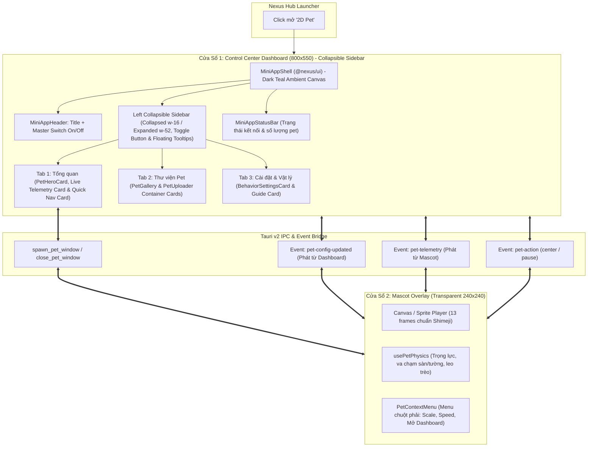

# 🐾 2D Pet - Tài Liệu Đặc Tả & Thiết Kế Kiến Trúc (Architecture & Specification)

> **2D Pet** là mini app độc lập trong hệ sinh thái **Nexus**, mang đến một nhân vật ảo Anime Chibi (Desktop Companion / Shimeji) di chuyển tự do, leo trèo và tương tác vật lý mượt mà trên macOS, được điều khiển toàn diện thông qua **Control Center Dashboard** chuẩn phong cách macOS.

---

## 1. Tổng Quan & Triết Lý Sản Phẩm

Khác với các ứng dụng desktop pet truyền thống thường thiếu giao diện quản lý tập trung hoặc làm vướng víu màn hình, **2D Pet** áp dụng mô hình **Dual-Window (Bảng Điều Khiển + Cửa Sổ Mascot Nổi)** với 4 giá trị cốt lõi:

1. **Control Center Dashboard Chuẩn Nexus (800x550)**:
   - Giao diện Dark Acrylic kính mờ (`window-vibrancy`), kế thừa trực tiếp [`MiniAppShell`](file:///Users/lethanhba/workspace/app/nexus/packages/ui/src/components/MiniAppShell.tsx) và [`MiniAppHeader`](file:///Users/lethanhba/workspace/app/nexus/packages/ui/src/components/MiniAppHeader.tsx) (an toàn 76px Traffic Lights).
   - Quản lý tập trung: Bật/Tắt Pet, xem trực tiếp trạng thái tọa độ live, chọn nhân vật trong thư viện và cấu hình vật lý.
2. **Cửa Sổ Nhân Vật Vô Hình (Transparent Mascot Overlay)**:
   - Cửa sổ con trong suốt 100% nổi tự do trên màn hình desktop khi công tắc Master Switch được kích hoạt.
   - Không viền, không bóng mờ chữ nhật, click-through thông minh không cản trở công việc.
3. **Động Cơ Vật Lý & Tự Hành Tinh Tế (Physics & Autonomous AI)**:
   - Trọng lực $g$ khi rơi tự do và tiếp đất nảy nhẹ (bounce dampening) ngay trên mép thanh macOS Dock.
   - Đi dạo ngẫu nhiên, leo trèo lên hai bên viền màn hình và nhảy dù xuống.
   - Nhấc bổng nhân vật bằng chuột thông qua API macOS native `startDragging()`.
4. **Hệ Thống Quản Lý Thư Viện & Lưu Trữ Bền Vững (Pet Registry & Persistent Storage)**:
   - Tích hợp sẵn 3 nhân vật: **Anya Forger**, **Bé Mèo Neko**, **Hatsune Miku**.
   - Hỗ trợ kéo thả thư mục Shimeji mới và lưu trữ bền vững vào `~/Library/Application Support/com.thanhba.nexus.pet2d/custom_pets/`.

---

## 2. Kiến Trúc Hai Cửa Sổ (Dual-Window Architecture)



---

## 3. Kiến Trúc Thanh Bên Điều Hướng Thu Gọn (Collapsible Left Sidebar) & Các Phân Khu Chức Năng

Để tối ưu hóa không gian hiển thị và tránh chèn ép thanh Header trên macOS, giao diện Dashboard chuyển đổi sang kiến trúc **Thanh Bên Thu Gọn (Left Collapsible Sidebar)** với 2 trạng thái hoạt động linh hoạt:

- **Nút Toggle Luôn Ở Đỉnh Sidebar**: Nút chuyển đổi (`PanelLeftClose` / `PanelLeftOpen`) được neo cố định trên đỉnh thanh bên kèm hiệu ứng hover rõ ràng.
- **Trạng Thái Thu Nhỏ (Collapsed - `w-16`)**:
  - Tối ưu diện tích bề ngang cho nội dung chính.
  - Hiển thị 3 biểu tượng chính căn giữa (`Sparkles`, `Layers`, `Sliders`).
  - **Floating Tooltip Thông Minh**: Khi người dùng hover chuột vào bất kỳ icon nào, một tooltip nổi kính mờ (`bg-[#041915]/95 border-[#00c49a]/40`) xuất hiện ngay bên phải hiển thị tên tab kèm phím tắt.
- **Trạng Thái Mở Rộng (Expanded - `w-56`)**:
  - Hiển thị thanh thoát Biểu tượng và Tên Tab ("Tổng quan", "Thư viện Pet", "Cài đặt & Vật lý"), tinh gọn không hiển thị badge phím tắt để tối ưu sự tập trung.
- **Khóa Cứng Trục Hoành Icon (Anchored Icon Position - Zero Jitter)**: Mọi biểu tượng (Toggle, Tabs) đều nằm trong hộp chứa cố định `w-12 shrink-0`, tâm icon luôn cố định ở vị trí X = 32px từ mép trái; khi đóng/mở sidebar chỉ có thanh title trượt mượt mà ra bên phải mà không làm icon dịch chuyển hay biến đổi kích thước.
- **Triệt Tiêu Hoàn Toàn Thanh Cuộn Ngang (Zero Horizontal Scrollbar)**: Sử dụng cấu trúc `overflow-visible` cho container tabs, đảm bảo không gian nổi cho tooltip và loại bỏ triệt để thanh cuộn ngang.
- **Hiệu Ứng Chuyển Động (Animation)**: Mượt mà chuẩn native với `transition-all duration-300 ease-in-out`.

### 3.1. Chuẩn Hóa Thẻ Container (Container Card Standardization)

Toàn bộ các phân khu chức năng được bao bọc đồng bộ trong thẻ chứa cao cấp mang phong cách kính mờ Dark Teal:

```tsx
relative shrink-0 overflow-hidden rounded-2xl bg-gradient-to-br from-[#082620]/85 via-[#061c18]/90 to-[#031411]/95 border border-[#00c49a]/30 p-5 shadow-2xl backdrop-blur-xl
```

### 3.2. Tab 1: Tổng Quan (Overview - ⌘1)

- **Thẻ PetHeroCard**:
  - Avatar động xem trước cử động với hiệu ứng glow xanh ngọc `#00c49a`.
  - Hiển thị tên nhân vật, mô tả, huy hiệu trạng thái (`Đang hoạt động` / `Đã thu hồi`).
  - **Master Switch (Công tắc Thả/Thu hồi Pet)**: Gạt công tắc để mở hoặc ẩn chú Pet ngoài desktop.
  - **Telemetry thời gian thực**: Trạng thái (`Walking`, `Idle`, `Climbing`, `Falling`) và tọa độ `(X, Y)` live.
  - **Nút phản ứng nhanh**: `Về giữa` (Center) và `Ghim vị trí` (Pause/Resume).
- **Thẻ Chỉ Số Giám Sát Thời Gian Thực (Live Telemetry Container Card)**:
  - Thẻ tọa độ Desktop `(X, Y)` & hướng di chuyển (`⬅️ Sang trái` / `➡️ Sang phải`).
  - Thẻ hành động Mascot & số lượng frame Shimeji.
  - Thẻ hồ sơ kích thước (`scale`), tốc độ (`speed`) và trạng thái gia tốc trọng lực.
- **Thẻ Chuyển Nhanh Phân Khu Chức Năng**: 2 nút điều hướng nhanh sang Thư viện Pet (`⌘2`) và Cài đặt nâng cao (`⌘3`).

### 3.3. Tab 2: Thư Viện Pet (Gallery & Import - ⌘2)

- **Thư Viện Nhân Vật (PetGallery)**:
  - Grid danh sách nhân vật có sẵn trong máy (Anya, Mèo Neko, Miku, custom pets).
  - Hover chuột để xem trước hoạt ảnh chuyển động.
  - Nút **"Chọn dùng"** (Set Active) với viền và nền nhấn `#00c49a`.
  - Nút xóa nhân vật tùy chỉnh (`deleteCustomPet`).
- **Tải Lên & Nhập Nhân Vật Mới (PetUploader)**:
  - Nhập đường dẫn thư mục ảnh Shimeji (`shime1.png` ... `shime13.png`).
  - Tự động kiểm tra tính hợp lệ và sao chép vào `~/Library/Application Support/com.thanhba.nexus.pet2d/custom_pets/`.

### 3.4. Tab 3: Cài Đặt & Vật Lý (Settings - ⌘3)

- **Bảng Cấu Hình Hành Vi (BehaviorSettingsCard)**:
  - **Kích thước**: `1.0x` (120px), `1.5x` (180px), `2.0x` (240px) với nút nhấn `#00c49a`.
  - **Tốc độ**: `Chậm`, `Tiêu chuẩn`, `Nhanh`.
  - **Gia tốc trọng lực**: Bật/tắt rơi tự do và nảy tiếp đất.
  - **Leo trèo viền màn hình**: Cho phép trèo lên mép trái/phải màn hình.
  - **Luôn nổi trên cùng**: Giữ pet luôn nằm trên các cửa sổ khác.
  - **Hướng dẫn tương tác macOS**: Mẹo kéo thả mascot native và menu chuột phải.

### 3.5. Hệ Thống Màu Nhận Diện & Full Theme Immersion (`#00c49a` Mint/Teal Dark Glassmorphism)

Toàn bộ ứng dụng 2D Pet tuân thủ nguyên tắc **Full App-wide Theme Immersion**, không sử dụng nền xám xỉn chung (`slate-950`) mà hòa mình vào không gian tối ánh xanh ngọc (Dark Teal Acrylic):

| Lớp Giao Diện          | Mã Hex / Biểu Thức CSS                                         | Semantic Token        | Vai Trò & Trải Nghiệm Thị Giác                                           |
| :--------------------- | :------------------------------------------------------------- | :-------------------- | :----------------------------------------------------------------------- |
| **Root Canvas**        | `#031411`                                                      | `bg-pet-canvas`       | Nền sâu thẳm đen ánh ngọc lục bảo (Dark Teal Black), dịu mắt và bí ẩn.   |
| **Ambient Glow**       | `radial-gradient(circle at 50% -10%, rgba(0,196,154,0.18)...)` | `.pet-ambient-canvas` | Hào quang ánh sáng ngọc lan tỏa từ đỉnh cửa sổ xuống các tab.            |
| **Surface 1 (Base)**   | `#061c18` (alpha: 0.8)                                         | `bg-pet-surface1`     | Lớp nền giếng (well), các nút hành động phụ và vùng đệm navigation.      |
| **Surface 2 (Card)**   | `#082620` (alpha: 0.65)                                        | `bg-pet-surface2`     | Thẻ chức năng, thẻ telemetry live, bảng settings kính acrylic mờ.        |
| **Surface 3 (Active)** | `#0e3d34` (alpha: 0.95)                                        | `bg-pet-surface3`     | Thẻ Pet đang được chọn active, vùng highlight trọng tâm.                 |
| **Header**             | `#051b17` (alpha: 0.9)                                         | `bg-pet-header`       | Thanh tiêu đề macOS tích hợp nút đóng/mở và segmented tab bar.           |
| **Footer / Status**    | `#041814` (alpha: 0.95)                                        | `bg-pet-footer`       | Thanh trạng thái 28px đáy cửa sổ hiển thị cổng 1423 & số lượng nhân vật. |
| **Borders**            | `rgba(0, 196, 154, 0.2 - 0.3)`                                 | `border-pet-border`   | Viền mờ ngăn cách tinh tế, phát sáng nhẹ khi hover (`0.45`).             |
| **Text Primary**       | `#f0fdf9`                                                      | `text-[#f0fdf9]`      | Trắng ánh ngọc độ tương phản cao, sắc nét trên màn hình Retina.          |
| **Text Secondary**     | `#5eead4`                                                      | `text-[#5eead4]`      | Xanh ngọc sáng dùng cho mô tả, tiêu đề phụ và thông số kỹ thuật.         |
| **Text Muted**         | `#2dd4bf/75`                                                   | `text-[#2dd4bf]/75`   | Xanh ngọc dịu nhẹ dùng cho nhãn frame count, tọa độ phụ.                 |
| **Scrollbar Thumb**    | `rgba(0, 196, 154, 0.25)`                                      | `.custom-scrollbar`   | Thanh cuộn mỏng 6px bo tròn chuẩn macOS, hover lên `0.5`.                |
| **Context Menu**       | `#041915/95`                                                   | -                     | Menu chuột phải ngoài desktop với nền kính mờ ngâm màu Dark Teal.        |

---

## 4. Đặc Tả API & Lệnh IPC Non-blocking

Mọi lệnh truy quét ổ cứng hoặc thao tác cửa sổ trong Rust đều tuân thủ nguyên tắc **Non-blocking IPC**:

| Tên Lệnh (Tauri Command) | Tham Số               | Giá Trị Trả Về                    | Mô Tả                                                  |
| :----------------------- | :-------------------- | :-------------------------------- | :----------------------------------------------------- |
| `spawn_pet_window`       | -                     | `Result<(), String>`              | Hiển thị cửa sổ mascot `pet-overlay`                   |
| `close_pet_window`       | -                     | `Result<(), String>`              | Ẩn cửa sổ mascot `pet-overlay`                         |
| `is_pet_spawned`         | -                     | `Result<bool, String>`            | Kiểm tra pet có đang hiển thị ngoài màn hình hay không |
| `show_dashboard_window`  | -                     | `Result<(), String>`              | Kích hoạt và đưa cửa sổ Dashboard lên trước            |
| `get_screen_bounds`      | -                     | `Result<ScreenBoundsDto, String>` | Lấy kích thước màn hình và tỷ lệ Retina                |
| `set_pet_position`       | `x: f64, y: f64`      | `Result<(), String>`              | Cập nhật vị trí cửa sổ pet trên màn hình               |
| `get_pet_position`       | -                     | `Result<(f64, f64), String>`      | Đọc tọa độ hiện tại của pet                            |
| `get_pet_library`        | -                     | `Result<Vec<PetItemDto>, String>` | Danh sách toàn bộ pet trong thư viện                   |
| `import_custom_pet`      | `folderPath, petName` | `Result<PetItemDto, String>`      | Copy và đăng ký pet mới vào Application Support        |
| `delete_custom_pet`      | `petId: String`       | `Result<(), String>`              | Xóa thư mục pet tùy chỉnh                              |

---

## 5. Hướng Dẫn Vận Hành & Khởi Chạy

```bash
# 1. Khởi chạy Dashboard trên giao diện Web dev (Port 1423)
pnpm --filter pet-2d dev

# 2. Khởi chạy toàn diện trên Desktop macOS (Bật Dashboard & Pet)
pnpm --filter pet-2d desktop

# Hoặc khởi chạy từ thư mục gốc:
pnpm dev:pet-2d

# 3. Kiểm tra kiểu dữ liệu TypeScript
pnpm --filter pet-2d typecheck

# 4. Kiểm tra Rust unit tests
cargo test -p pet_2d
```
