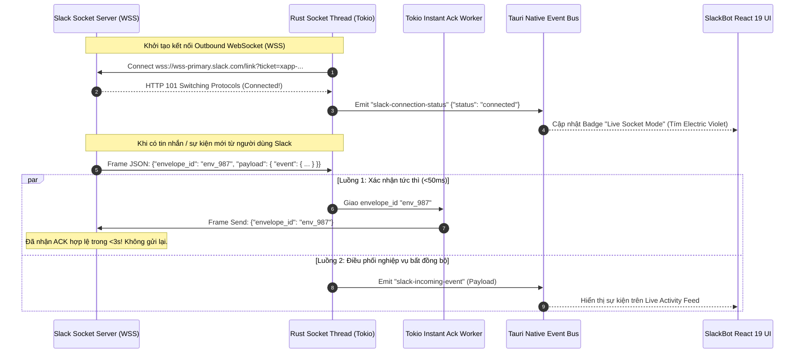
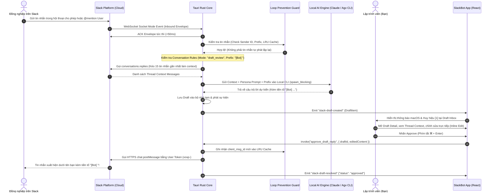
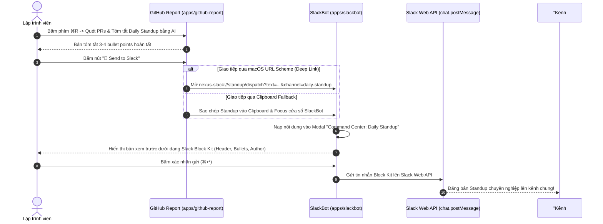
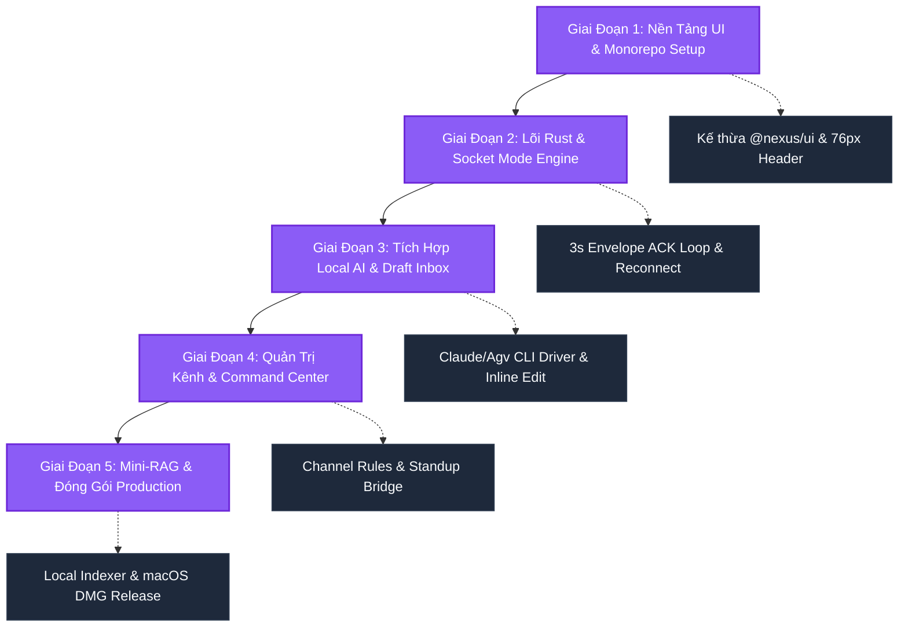

# 🤖 SlackBot - Tài Liệu Đặc Tả & Thiết Kế Kiến Trúc

> **SlackBot** là ứng dụng độc lập trong hệ sinh thái **Nexus**, hỗ trợ lập trình viên và các đội nhóm kỹ thuật tự động hóa phản hồi trên Slack thông qua kết nối an toàn **Slack Socket Mode (Firewall-Friendly)**. Ứng dụng hoạt động trực tiếp dưới **Danh tính Tài Khoản Cá Nhân của Người Dùng (User Account Token `xoxp-`)**, kết hợp cơ chế gắn tiền tố nhận diện minh bạch (**Message Prefix Engine** như `[Bot] `), quản lý hội thoại theo danh sách cho phép (**Conversation Whitelist & Per-Conversation Rules**), kiểm duyệt thông minh **Human-in-the-Loop (Draft & Review)** và năng lực tính toán của **Local AI (Zero-Token Cost)**.

---

## 1. Tổng Quan & Triết Lý Sản Phẩm

### 1.1. Bối Cảnh & Thách Thức Nghiệp Vụ

Trong môi trường làm việc kỹ thuật hiện đại, Slack là kênh giao tiếp trung tâm. Tuy nhiên, lập trình viên và các Tech Lead thường xuyên đối mặt với 3 bài toán nan giải:

1. **Quá Tải Tin Nhắn & Phân Mảnh Chú Ý**: Lập trình viên liên tục bị ngắt quãng dòng suy nghĩ (context switching) để trả lời các câu hỏi lặp đi lặp lại về quy trình CI/CD, trạng thái deploy, tài liệu API, hoặc các thắc mắc nghiệp vụ cơ bản.
2. **Rào Cản Xin Cấp Quyền Cài Đặt Bot Ứng Dụng (Workspace App Admin Barrier)**: Để tạo một Bot riêng biệt (`xoxb-...`), người dùng thường phải xin phê duyệt khắt khe từ Workspace Admin/Security Team của công ty. Điều này gây cản trở và mất thời gian đối với nhu cầu trợ lý cá nhân.
3. **Lo Ngại Bot Tự Động Gây Ra Ảo Giác (Hallucination Risk)**: Các bot tự động trả lời hoàn toàn (auto-reply bots) thường tiềm ẩn nguy cơ phát ngôn sai lệch trong các kênh thảo luận quan trọng của doanh nghiệp, gây hiểu lầm hoặc tiết lộ thông tin nội bộ ngoài ý muốn.
4. **Rào Cản Tường Lửa (Corporate Firewall & Inbound NAT)**: Mô hình Slack Webhook truyền thống bắt buộc máy chủ bot phải mở port công khai ra internet (sử dụng ngrok hoặc mở public reverse proxy). Điều này vi phạm nghiêm ngặt chính sách bảo mật mạng nội bộ của hầu hết doanh nghiệp.

### 1.2. Bốn Trụ Cột Triết Lý Của SlackBot

Để giải quyết triệt để các thách thức trên, **SlackBot** được thiết kế dựa trên 4 trụ cột cốt lõi:

```
┌────────────────────────────────────────────────────────────────────────────────────────┐
│                                 4 TRỤ CỘT TRIẾT LÝ SLACKBOT                            │
├────────────────────────────┬────────────────────────────┬──────────────────────────────┤
│ 1. USER ACCOUNT DELEGATION │ 2. HUMAN-IN-THE-LOOP       │ 3. ZERO-TOKEN COST FIRST     │
│ • User Token (xoxp-)       │ • Draft & Review Inbox     │ • Claude Code CLI & Agv CLI  │
│ • Socket Mode (xapp-)      │ • Per-Conversation Rules  │ • Ollama Local Models        │
│ • Message Prefix [Bot]     │ • Phê duyệt nhanh (⌘↵)     │ • macOS Keychain Secure Keys │
├────────────────────────────┴────────────────────────────┴──────────────────────────────┤
│ 4. CHUẨN THẨM MỸ macOS & NEXUS AESTHETIC                                              │
│ • Dark Acrylic Vibrancy • Màu nhấn Electric Violet (#8b5cf6) • Titlebar 76px Traffic Lights│
│ • Bộ UI dùng chung @nexus/ui • Hiển thị Stale-While-Revalidate • Non-blocking Rust IPC │
└────────────────────────────────────────────────────────────────────────────────────────┘
```

1. **Firewall-Friendly & User Account Identity Delegation (Danh Tính Cá Nhân Ủy Quyền)**:
   - Ứng dụng kết nối trực tiếp đến Slack qua kết nối WebSocket hai chiều gửi ra ngoài (Outbound WebSocket `wss://wss-primary.slack.com/link`). Không cần mở port inbound, không cần public IP hay ngrok, hoạt động trơn tru sau NAT và tường lửa doanh nghiệp.
   - **Hoạt Động Dưới Danh Tính Người Dùng (`xoxp-...`)**: Thay vì tạo bot app riêng rườm rà, SlackBot sử dụng **User Account Token** (`xoxp-...`) của chính bạn kết hợp với **App-Level Token** (`xapp-...` với scope `connections:write`). Bot đóng vai trò "người thư ký ảo thông minh" đại diện cho chính bạn trong các luồng thảo luận.

   > [!IMPORTANT]
   > **Quyết Định Kiến Trúc**: Tính năng "Tạo Bot riêng (`xoxb-...`)" tạm thời được **vô hiệu hóa (disabled)** để loại bỏ hoàn toàn rào cản phê duyệt từ ban quản trị Slack Workspace. Ứng dụng tập trung 100% vào việc tối ưu trải nghiệm ủy quyền tài khoản cá nhân.

2. **Cơ Chế Tiền Tố Nhận Diện (Message Prefix Engine) & Minh Bạch Hóa AI**:
   - Khi phản hồi tự động hoặc gửi bản nháp đã duyệt, ứng dụng luôn tự động thêm tiền tố nhận diện vào đầu câu, mặc định là `[Bot] ` (ví dụ: `[Bot] Mình đã cập nhật pull request #42 rồi nhé!`).
   - Người dùng có thể tùy biến tiền tố toàn cục (`🤖 [AI Assistant] `, `[Trợ Lý] `) hoặc cấu hình tiền tố riêng cho từng hội thoại cụ thể.
   - Giúp đồng nghiệp nhận biết rõ ràng câu trả lời nào được hỗ trợ bởi AI, đảm bảo văn hóa giao tiếp minh bạch và chuyên nghiệp.

3. **Human-in-the-Loop & Cấu Hình Độc Lập Từng Hội Thoại (Per-Conversation Rules)**:
   - **Hộp Thư Duyệt (Draft & Review Inbox)**: AI phân tích ngữ cảnh luồng trao đổi (Thread Context), soạn sẵn bản nháp câu trả lời tốt nhất kèm tiền tố và đẩy vào Draft Inbox. Người dùng kiểm tra, sửa trực tiếp (Inline Edit), bấm Approve (<kbd>⌘</kbd> + <kbd>Enter</kbd>) để gửi hoặc Discard (<kbd>Esc</kbd>) để hủy bỏ.
   - **Quản Lý Hội Thoại Cho Phép (Conversation Whitelist)**: Hỗ trợ linh hoạt cho cả 4 loại hội thoại Slack:
     - Kênh công khai (`public_channel`)
     - Kênh riêng tư (`private_channel`)
     - Nhóm chat nhỏ (`mpdm` - Multi-Person Direct Message)
     - Tin nhắn trực tiếp 1-1 (`im` - Direct Message)
   - Cho phép **cấu hình riêng biệt cho từng hội thoại**: Bật/Tắt hoạt động, chọn Chế độ phản hồi (_Auto-pilot / Draft & Review / Manual Only_), đặt Tiền tố riêng (`customPrefix`), và điều chỉnh Giọng văn riêng (`customTone`).

4. **Zero-Token Cost First & Multi-Provider AI (Tối Ưu Chi Phí)**:
   - Kế thừa triết lý từ [GitHub Report](file:///Users/lethanhba/workspace/app/nexus/docs/github-report.md), SlackBot ưu tiên sử dụng phiên đăng nhập CLI có sẵn trên máy Mac (`claude` Code CLI, `agy` Antigravity CLI, hoặc `ollama`), hoàn toàn không phát sinh chi phí token API bên ngoài.
   - Cung cấp cơ chế chuyển đổi dự phòng (Fallback) sang Cloud API (Anthropic Claude 3.5 Sonnet, OpenAI GPT-4o, DeepSeek) với API key được mã hóa và bảo vệ an toàn trong **macOS Keychain** thông qua Apple Secure Enclave.

5. **Chuẩn Thẩm Mỹ macOS & Nexus Aesthetic**:
   - Giao diện Dark Acrylic Vibrancy sang trọng, tinh tế.
   - Điểm nhấn nhận diện thương hiệu màu tím **Electric Violet / Slack Aubergine `#8b5cf6`** (lấy cảm hứng từ sắc tím thương hiệu kinh điển của Slack, tuân thủ kiến trúc phân tách bảng màu độc lập trong [Nexus UI/UX Design System](file:///Users/lethanhba/workspace/app/nexus/docs/ui-ux-design-system.md) và được định nghĩa đồng bộ trong [`NEXUS_APPS`](file:///Users/lethanhba/workspace/app/nexus/packages/shared/src/constants/app-info.ts)).
   - Tích hợp chuẩn **Unified Window Titlebar** với vùng đệm an toàn 76px (`leftSafeWidth={76}`) dành cho 3 nút Traffic Lights gốc của macOS.
   - Kế thừa toàn bộ hệ sinh thái linh kiện `@nexus/ui` tuân thủ nghiêm ngặt nguyên tắc **Event-Driven**, **Stale-While-Revalidate** (`AsyncContent`) và **Non-blocking Rust IPC**.

### 1.3. Bảng Thông Số Thiết Kế & CSS Tokens (Electric Violet Palette)

Theo chuẩn [Mini-App Palette Identity Architecture](file:///Users/lethanhba/workspace/app/nexus/docs/ui-ux-design-system.md#31-mini-app-palette-identity-architecture-h-thng-bng-mu-nhn-din-c-lp), SlackBot sở hữu hệ màu nhận diện riêng biệt:

| Semantic Token      | Giá Trị Màu (Hex / RGBA)   | Tailwind Class Mẫu                                      | Áp Dụng Trong Giao Diện SlackBot                                   |
| :------------------ | :------------------------- | :------------------------------------------------------ | :----------------------------------------------------------------- |
| **`accent-base`**   | `#8b5cf6` (Violet 500)     | `bg-violet-600`, `text-violet-400`                      | Nút Duyệt Gửi (Approve ⌘↵), Icon Header, Active Tab, Selection     |
| **`accent-hover`**  | `#a78bfa` (Violet 400)     | `hover:bg-violet-500`, `hover:text-violet-300`          | Trạng thái hover của các nút hành động, liên kết                   |
| **`accent-active`** | `#7c3aed` (Violet 600)     | `active:bg-violet-700`                                  | Trạng thái nhấn chuột nút gửi, nút kích hoạt Socket Mode           |
| **`accent-glow`**   | `rgba(139, 92, 246, 0.18)` | `shadow-[0_0_24px_rgba(139,92,246,0.18)]`               | Hào quang mờ xung quanh App Icon và Connection Badge khi Connected |
| **`accent-ring`**   | `rgba(139, 92, 246, 0.40)` | `focus-visible:ring-violet-500/40`                      | Viền focus bàn phím chuẩn macOS (Accessible Focus Indicator)       |
| **`accent-badge`**  | `rgba(139, 92, 246, 0.12)` | `bg-violet-500/10 text-violet-300 border-violet-500/25` | Huy hiệu số lượng Draft chờ duyệt, Badge Live Socket Mode          |
| **`accent-border`** | `rgba(139, 92, 246, 0.30)` | `border-violet-500/30`                                  | Viền nổi bật quanh Card câu trả lời AI đang được chỉnh sửa         |

---

## 2. Kiến Trúc Kỹ Thuật & Tổ Chức Mã Nguồn

### 2.1. Sơ Đồ Khối Đa Tầng (Multi-Tier Architecture)

```
┌───────────────────────────────────────────────────────────────────────────────────┐
│                        TẦNG GIAO DIỆN NGƯỜI DÙNG (REACT 19 UI)                    │
│                                                                                   │
│  [ MiniAppHeader (76px Safe) ] ── [ Live Feed / Draft Inbox ] ── [ Status Bar ]   │
│  [ useAppBootstrap ] ── [ useAsyncTask ] ── [ AsyncContent ] ── [ useHotkeys ]    │
│  [ Conversation Manager ] ────── [ Message Prefix Engine ] ───── [ Persona Studio]│
│  Linh kiện chuẩn: @nexus/ui • @nexus/shared • Tailwind CSS • Lucide Icons        │
└────────────────────────────────────────┬──────────────────────────────────────────┘
                                         │ Tauri Native IPC (Async Commands / Events)
┌────────────────────────────────────────▼──────────────────────────────────────────┐
│                         TẦNG NATIVE RUST (TAURI V2 CORE)                          │
│                                                                                   │
│  ┌──────────────────────┐  ┌──────────────────────┐  ┌─────────────────────────┐  │
│  │ Socket Mode Engine   │  │ Draft & AI Manager   │  │ Conversation Rules &    │  │
│  │ (Tokio WebSocket)    │  │ (Async Task Runner)  │  │ Whitelist Evaluator     │  │
│  └──────────┬───────────┘  └──────────┬───────────┘  └────────────┬────────────┘  │
│             │                         │                           │               │
│             ▼                         ▼                           ▼               │
│  ┌──────────────────────┐  ┌──────────────────────┐  ┌─────────────────────────┐  │
│  │ 3-Second Envelope    │  │ Loop Prevention      │  │ Local Knowledge Mini-RAG│  │
│  │ Acknowledger Loop    │  │ Guard (3-Layer Anti) │  │ (Indexed Docs Scanner)  │  │
│  └──────────────────────┘  └──────────────────────┘  └─────────────────────────┘  │
└────────────┬──────────────────────────┬───────────────────────────┬───────────────┘
             │                          │                           │
             ▼                          ▼                           ▼
┌─────────────────────────┐ ┌─────────────────────────┐ ┌─────────────────────────┐
│     HỆ THỐNG MACOS      │ │   LOCAL / CLOUD AI      │ │      SLACK CLOUD      │
│ • Apple Keychain        │ │ • Claude Code CLI       │ │ • Socket Mode WSS       │
│ • Secure Enclave        │ │ • Antigravity CLI (agy) │ │ • Slack Web API (HTTPS) │
│ • Native Notification   │ │ • Ollama (Local LLM)    │ │   (User Token xoxp-)    │
│ • tauri-plugin-store    │ │ • Cloud APIs (Keychain) │ │   - chat.postMessage    │
└─────────────────────────┘ └─────────────────────────┘ └─────────────────────────┘
```

### 2.2. Tổ Chức Thư Mục Mã Nguồn (`apps/slackbot/`)

Cấu trúc mã nguồn của `slackbot` được tổ chức tách bạch rõ ràng giữa giao diện người dùng React 19 và nhân backend Rust Tauri v2:

```text
apps/slackbot/
├── index.html
├── package.json
├── postcss.config.js
├── tailwind.config.js
├── tsconfig.json
├── vite.config.ts
├── .env.example
├── src/
│   ├── main.tsx                         # Entry point ứng dụng React
│   ├── App.tsx                          # Điều phối chính (<120 dòng), gắn kết MiniAppShell
│   ├── env.ts                           # Validate biến môi trường bằng Zod
│   ├── index.css                        # Tailwind & acrylic vibrancy base styles
│   ├── types/
│   │   ├── slack.ts                     # Interface tin nhắn, user, conversation, draft item
│   │   ├── settings.ts                  # Interface cấu hình SlackBotSettings & ConversationRule
│   │   └── ipc.ts                       # Typed payload cho commands và events Tauri
│   ├── lib/
│   │   ├── prefix-engine.ts             # Quản lý ghép/tách tiền tố [Bot], custom prefix theo hội thoại
│   │   ├── slack-formatter.ts           # Xử lý cú pháp mrkdwn, convert Block Kit sang text
│   │   └── thread-utils.ts              # Trích xuất và định dạng ngữ cảnh thread hội thoại
│   ├── services/
│   │   ├── slackbot-api.ts              # Tập trung hóa toàn bộ lệnh invoke Native IPC
│   │   └── storage.ts                   # Quản lý đọc/ghi settings.json qua tauri-plugin-store
│   ├── hooks/
│   │   ├── use-slack-settings.ts        # Quản lý cấu hình danh tính, persona và token status
│   │   ├── use-slack-socket.ts          # Quản lý trạng thái kết nối WebSocket thời gian thực
│   │   ├── use-draft-inbox.ts           # Quản lý danh sách bản nháp câu trả lời chờ duyệt
│   │   └── use-conversation-rules.ts   # Quản lý danh sách hội thoại cho phép và quy tắc riêng
│   └── components/
│       ├── UnifiedHeader.tsx            # Bọc MiniAppHeader với 76px Traffic Lights an toàn
│       ├── StatusBar.tsx                # Bọc MiniAppStatusBar hiển thị trạng thái kết nối & tài khoản
│       ├── SettingsModal.tsx            # Modal cấu hình User Token, App Token, AI Provider, Persona
│       ├── dashboard/
│       │   ├── ConnectionIndicator.tsx  # Badge hiển thị Socket Mode status (Live/Disconnected)
│       │   ├── AccountBadge.tsx         # Thẻ hiển thị thông tin tài khoản cá nhân đang ủy quyền
│       │   ├── MetricsBar.tsx           # Thống kê nhanh: tin nhắn hôm nay, draft đã duyệt
│       │   └── ActivityFeed.tsx         # Luồng sự kiện tin nhắn thời gian thực
│       ├── inbox/
│       │   ├── DraftList.tsx            # Danh sách bản nháp cần duyệt (phân loại theo hội thoại)
│       │   ├── DraftDetailCard.tsx      # Khung xem chi tiết thread, tiền tố [Bot] & Inline Edit
│       │   └── GhostwriterPills.tsx     # 3 nút gợi ý phản hồi nhanh (Quick Suggestions)
│       ├── conversations/
│       │   ├── ConversationRuleTable.tsx# Bảng phân quyền chế độ Auto / Draft / Manual cho từng hội thoại
│       │   ├── CustomPrefixModal.tsx    # Modal cấu hình tiền tố riêng biệt cho từng kênh/DM
│       │   └── WhitelistModal.tsx       # Quản lý danh sách thành viên được kích hoạt bot
│       └── command-center/
│           ├── NaturalLanguageBar.tsx   # Thanh ra lệnh tự nhiên kèm AI Intent Parser
│           ├── StandupBridgeModal.tsx   # Modal nhận standup từ github-report và gửi vào Slack
│           └── ScheduledMessageList.tsx # Danh sách tin nhắn gửi tự động theo lịch (Cron)
└── src-tauri/
    ├── Cargo.toml                       # Khai báo crate dependencies (tokio, tungstenite, keyring...)
    ├── build.rs                         # Tauri build script
    ├── tauri.conf.json                  # Cấu hình chính thức của SlackBot
    ├── tauri.dev.conf.json              # Cấu hình độc lập cho môi trường phát triển (Dev)
    ├── capabilities/
    │   └── default.json                 # Phân quyền Tauri plugin permissions
    └── src/
        ├── main.rs                      # Khởi chạy binary
        ├── lib.rs                       # Entry point tauri::Builder và đăng ký commands
        ├── error.rs                     # Hệ thống định nghĩa lỗi tập trung (thiserror)
        ├── slack/
        │   ├── mod.rs                   # Module Slack facade
        │   ├── socket_client.rs         # Vòng lặp kết nối WebSocket Socket Mode & Auto-reconnect
        │   ├── envelope.rs              # Mô hình Envelope, Envelope Ack (3s timeout) & Dispatcher
        │   └── web_api.rs               # Client gọi Slack Web API (chat.postMessage, conversations.replies)
        ├── guard/
        │   ├── mod.rs                   # Module bảo vệ & lọc gói tin
        │   └── loop_prevention.rs       # 3-Layer Loop Prevention Guard (chống tự chat lặp vô tận)
        ├── ai/
        │   ├── mod.rs                   # Quản lý tương tác với các AI Engine
        │   ├── cli_driver.rs            # Thực thi non-blocking CLI (claude / agy) qua spawn_blocking
        │   ├── cloud_client.rs          # Gọi Cloud AI API (Anthropic / OpenAI)
        │   └── prompt_builder.rs        # Ghép ngữ cảnh Thread, Persona, Prefix và Docs thành prompt
        └── storage/
            ├── mod.rs                   # Quản lý dữ liệu bền vững
            └── keychain.rs              # Đọc/ghi Token an toàn vào macOS Keychain qua `keyring`
```

---

## 3. Phân Tách Môi Trường & Lưu Trữ Dữ Liệu

Tuân thủ nghiêm ngặt quy chuẩn phân tách môi trường trong [Coding Standards](file:///Users/lethanhba/workspace/app/nexus/docs/coding-standards.md) và [Mini-App Guide](file:///Users/lethanhba/workspace/app/nexus/docs/mini-app-guide.md), dữ liệu cấu hình và token bảo mật của SlackBot trong môi trường Dev và Production được cô lập hoàn toàn:

### 3.1. Bảng Quy Chuẩn Phân Tách Môi Trường (Dev vs Prod Isolation)

| Tiêu chí                          | Môi trường Development (Dev)                                    | Môi trường Production                                       |
| :-------------------------------- | :-------------------------------------------------------------- | :---------------------------------------------------------- |
| **App Bundle ID**                 | `com.thanhba.nexus.slackbot.dev`                                | `com.thanhba.nexus.slackbot`                                |
| **Tên ứng dụng hiển thị**         | `SlackBot (Dev)`                                                | `SlackBot`                                                  |
| **Thư mục Application Support**   | `~/Library/Application Support/com.thanhba.nexus.slackbot.dev/` | `~/Library/Application Support/com.thanhba.nexus.slackbot/` |
| **File cấu hình Store**           | `settings.json` (trong thư mục dev)                             | `settings.json` (trong thư mục prod)                        |
| **macOS Keychain Service**        | `nexus-slackbot-dev`                                            | `nexus-slackbot`                                            |
| **Keychain Account (User Token)** | `slack_user_token_dev` (`xoxp-...`)                             | `slack_user_token` (`xoxp-...`)                             |
| **Keychain Account (App Token)**  | `slack_app_token_dev` (`xapp-...`)                              | `slack_app_token` (`xapp-...`)                              |
| **Keychain Account (Cloud AI)**   | `ai_api_key_dev`                                                | `ai_api_key`                                                |
| **Web Fallback (LocalStorage)**   | `nexus_slackbot_settings_dev`                                   | `nexus_slackbot_settings`                                   |
| **Lệnh chạy từ root**             | `pnpm dev:slackbot` hoặc `pnpm desktop`                         | Bản đóng gói `.dmg` cài đặt vào `/Applications`             |

> [!NOTE]
> **Quy Chuẩn Token**: SlackBot sử dụng `slack_user_token` (`xoxp-...`, đại diện cho tài khoản cá nhân) và `slack_app_token` (`xapp-...`, dùng duy trì Socket Mode kết nối máy chủ Slack). Token bot ứng dụng (`xoxb-...`) tạm thời không sử dụng.

### 3.2. Cấu Trúc File `settings.json` (`tauri-plugin-store`)

File cấu hình được lưu cục bộ dưới định dạng JSON, quản lý bởi plugin chính thức `tauri-plugin-store`:

```json
{
  "version": 2,
  "identity": {
    "mode": "user_account",
    "userId": "U0123456789",
    "userName": "thanh.ba",
    "defaultPrefix": "[Bot] ",
    "enablePrefix": true,
    "botAppModeDisabled": true
  },
  "slack": {
    "socketModeEnabled": true,
    "reconnectIntervalSec": 5,
    "maxReconnectAttempts": 10,
    "autoAckEnvelope": true
  },
  "ai": {
    "provider": "auto",
    "localEngine": "claude",
    "fallbackCloudModel": "claude-3-5-sonnet-latest",
    "temperature": 0.3,
    "maxTokens": 1024,
    "systemPrompt": "Bạn là trợ lý kỹ thuật thông minh đại diện cho người dùng trên Slack. Hãy trả lời ngắn gọn, chuẩn xác, ưu tiên giải pháp code rõ ràng, lịch sự và hỗ trợ đồng đội tận tình."
  },
  "persona": {
    "displayName": "Thành Bá (AI Assistant)",
    "tone": "professional_friendly",
    "pronoun": "mình_bạn",
    "signature": "— _Soạn tự động bởi SlackBot_",
    "defaultLanguage": "vi"
  },
  "conversations": [
    {
      "conversationId": "C0123456789",
      "name": "proj-nexus-dev",
      "type": "public_channel",
      "enabled": true,
      "mode": "draft_review",
      "customPrefix": "[Bot] ",
      "customTone": "professional_technical",
      "autoReplyMentionsOnly": true,
      "whitelistUserIds": [],
      "blacklistKeywords": ["pass", "secret", "private_key", "password"]
    },
    {
      "conversationId": "C0987654321",
      "name": "sandbox-ai-test",
      "type": "public_channel",
      "enabled": true,
      "mode": "auto_pilot",
      "customPrefix": "🤖 [AI] ",
      "customTone": "concise",
      "autoReplyMentionsOnly": false,
      "whitelistUserIds": [],
      "blacklistKeywords": []
    },
    {
      "conversationId": "G0112233445",
      "name": "standup-sync-group",
      "type": "mpdm",
      "enabled": true,
      "mode": "draft_review",
      "customPrefix": "[Bot] ",
      "customTone": "friendly",
      "autoReplyMentionsOnly": false,
      "whitelistUserIds": [],
      "blacklistKeywords": []
    },
    {
      "conversationId": "D0998877665",
      "name": "direct-hoang-tran",
      "type": "im",
      "enabled": true,
      "mode": "draft_review",
      "customPrefix": "[Trợ Lý] ",
      "customTone": "friendly",
      "autoReplyMentionsOnly": false,
      "whitelistUserIds": [],
      "blacklistKeywords": []
    }
  ],
  "loopPrevention": {
    "enabled": true,
    "filterSelfPrefix": true,
    "lruCacheSize": 100
  },
  "draftInbox": {
    "retentionHours": 24,
    "autoDiscardExpired": true,
    "notifyOnNewDraft": true,
    "playNotificationSound": true
  },
  "smartContext": {
    "maxThreadHistory": 15,
    "includeChannelTopic": true,
    "includeUserProfiles": true
  },
  "knowledgeBase": {
    "enabled": true,
    "localDocsPath": "~/workspace/app/nexus/docs",
    "fileExtensions": [".md", ".txt"]
  }
}
```

### 3.3. Cơ Chế Chống Lặp Vòng Tròn (Loop Prevention Guard Architecture)

Khi hoạt động dưới danh tính tài khoản cá nhân của User (`xoxp-...`), mọi tin nhắn do ứng dụng gửi đi sẽ mang ID người gửi chính là User (`event.user == current_user_id`). Khi đó, WebSocket Socket Mode sẽ nhận lại chính sự kiện tin nhắn này từ máy chủ Slack.

Nếu không có cơ chế lọc nghiêm ngặt, bot sẽ hiểu nhầm đây là tin nhắn mới cần trả lời, dẫn đến **vòng lặp vô tận (Infinite Chat Loop)** làm spam kênh chat và cạn kiệt tài nguyên.

SlackBot triển khai kiến trúc **3-Layer Loop Prevention Guard** trong lõi Rust:

```
┌────────────────────────────────────────────────────────────────────────────────────────┐
│                        KIẾN TRÚC 3-LAYER LOOP PREVENTION GUARD                         │
├────────────────────────────────────────────────────────────────────────────────────────┤
│ [Sự kiện Socket Mode đến] ──► Lớp 1: User ID & Prefix Filter                          │
│                                │ • event.user == current_user_id                       │
│                                │ • text.starts_with(prefix) -> BỎ QUA NGAY (DROP)       │
│                                ▼                                                       │
│                               Lớp 2: LRU Sent Message ID Cache                         │
│                                │ • client_msg_id nằm trong 100 ID bot vừa gửi          │
│                                │ -> BỎ QUA NGAY (DROP)                                 │
│                                ▼                                                       │
│                               Lớp 3: Conversation Whitelist Guard                     │
│                                │ • conversation_id KHÔNG nằm trong danh sách bật (ON)  │
│                                │ -> BỎ QUA (IGNORE)                                    │
│                                ▼                                                       │
│                          [Đủ điều kiện đưa vào xử lý AI]                              │
└────────────────────────────────────────────────────────────────────────────────────────┘
```

1. **Lớp 1 - User ID & Message Prefix Verification**:
   - Nếu `event.user == current_user_id` và nội dung bắt đầu bằng bất kỳ tiền tố nhận diện nào (`[Bot] `, `🤖 [AI] `, v.v.) ➔ Bỏ qua ngay lập tức.
2. **Lớp 2 - LRU Sent Message ID Cache**:
   - Khi `chat.postMessage` gửi đi thành công, Rust backend lưu `client_msg_id` vào bộ nhớ đệm tròn (Ring Buffer / LRU Cache 100 phần tử). Bất kỳ sự kiện inbound nào mang ID trùng khớp sẽ bị hủy bỏ tức thì.
3. **Lớp 3 - Conversation Whitelist & Status Check**:
   - Chỉ xử lý các tin nhắn thuộc các hội thoại nằm trong danh sách `conversations` với trạng thái `enabled: true`. Mọi hội thoại khác đều bị bỏ qua trong im lặng.

---

## 4. Luồng Dữ Liệu & Biểu Đồ Trình Tự (Mermaid Sequence Diagrams)

### 4.1. Luồng 1: Socket Mode Handshake & Vòng Lặp 3-Second Envelope ACK

Slack Socket Mode yêu cầu client phải xác nhận (ACK) bất kỳ payload Envelope nào nhận được qua WebSocket trong vòng tối đa **3 giây** (`{"envelope_id": "xyz"}`). Nếu client không gửi ACK kịp thời, Slack coi như kết nối bị treo và sẽ liên tục gửi lại gói tin hoặc ngắt kết nối:



### 4.2. Luồng 2: Luồng Duyệt Bán Tự Động (Human-in-the-Loop Draft & Review)

Đây là luồng hoạt động trung tâm bảo đảm không bao giờ xảy ra lỗi phát ngôn hoặc ảo giác:



### 4.3. Luồng 3: Trung Tâm Điều Khiển & Cầu Nối Liên Ứng Dụng (Cross-App Standup Bridge)

Tích hợp mượt mà giữa **GitHub Report** và **SlackBot** trong cùng hệ sinh thái Nexus:



---

## 5. Đặc Tả Native IPC Commands & Event Contracts (Rust Backend)

### 5.1. Bảng Chi Tiết 16 Tauri Native IPC Commands

Mọi command đều được xử lý bất đồng bộ trong Rust qua `tauri::async_runtime::spawn_blocking` hoặc luồng Tokio async để đảm bảo luồng giao diện React không bao giờ bị giật lag:

| #   | Command Name                   | Tham Số Đầu Vào                                                                             | Kết Quả Trả Về                              | Mô Tả Nghiệp Vụ                                                                                                                                                                                            |
| :-- | :----------------------------- | :------------------------------------------------------------------------------------------ | :------------------------------------------ | :--------------------------------------------------------------------------------------------------------------------------------------------------------------------------------------------------------- |
| 1   | `check_slack_status`           | Không có                                                                                    | `SlackStatusDto`                            | Kiểm tra trạng thái WebSocket, kiểm tra sự tồn tại của User Token trong Keychain và trạng thái sẵn sàng của Local AI CLI (`claude`/`agy`).                                                                 |
| 2   | `connect_socket_mode`          | Không có                                                                                    | `Result<(), String>`                        | Khởi tạo kết nối Socket Mode WebSocket client đến máy chủ Slack (`wss://...`). Bắt đầu vòng lặp lắng nghe sự kiện.                                                                                         |
| 3   | `disconnect_socket_mode`       | Không có                                                                                    | `Result<(), String>`                        | Ngắt kết nối WebSocket client một cách an toàn (graceful shutdown), dừng luồng nhận tin.                                                                                                                   |
| 4   | `save_slack_credentials`       | `user_token: String`, `app_token: String`                                                   | `Result<(), String>`                        | Lưu User OAuth Token (`xoxp-...`) và App-Level Token (`xapp-...`) vào macOS Keychain an toàn.                                                                                                              |
| 5   | `get_slack_credentials`        | Không có                                                                                    | `Result<SlackCredentialsDto, String>`       | Lấy cặp token User Token và App Token đã lưu từ macOS Keychain (ẩn ký tự nhạy cảm khi trả về giao diện).                                                                                                   |
| 6   | `fetch_slack_conversations`    | `types: Option<String>`                                                                     | `Result<Vec<SlackConversationDto>, String>` | Gọi Slack Web API `conversations.list` để lấy danh sách toàn bộ các kênh (public, private), nhóm chat (mpdm) và tin nhắn 1-1 (im).                                                                         |
| 7   | `save_conversation_rule`       | `conversation_id: String`, `rule: ConversationRuleDto`                                      | `Result<(), String>`                        | Lưu cấu hình độc lập cho từng hội thoại: Bật/Tắt, chế độ phản hồi (Draft & Review / Auto-pilot / Manual), Tiền tố riêng (`customPrefix`), Tone riêng.                                                      |
| 8   | `fetch_thread_replies`         | `channel_id: String`, `thread_ts: String`                                                   | `Result<Vec<SlackMessageDto>, String>`      | Gọi `conversations.replies` để lấy lịch sử 15-20 tin nhắn trong một thread cụ thể làm ngữ cảnh cho AI.                                                                                                     |
| 9   | `send_slack_message`           | `channel_id: String`, `text: String`, `thread_ts: Option<String>`, `prefix: Option<String>` | `Result<SlackMessageResultDto, String>`     | Gửi tin nhắn dưới danh tính cá nhân người dùng (`xoxp-`), tự động chèn tiền tố nhận diện (`[Bot] `) vào đầu nội dung.                                                                                      |
| 10  | `fetch_pending_drafts`         | Không có                                                                                    | `Vec<DraftItemDto>`                         | Lấy danh sách toàn bộ các bản nháp câu trả lời đang chờ người dùng xem xét duyệt trong Draft Inbox.                                                                                                        |
| 11  | `approve_draft_reply`          | `draft_id: String`, `edited_text: Option<String>`                                           | `Result<(), String>`                        | Phê duyệt bản nháp (kèm nội dung chỉnh sửa nếu có), gửi lên Slack dưới tên bạn và xóa draft khỏi danh sách chờ.                                                                                            |
| 12  | `discard_draft_reply`          | `draft_id: String`                                                                          | `Result<(), String>`                        | Loại bỏ một bản nháp khỏi danh sách chờ mà không gửi bất kỳ tin nhắn nào lên Slack.                                                                                                                        |
| 13  | `regenerate_draft_ai`          | `draft_id: String`, `custom_instruction: Option<String>`                                    | `Result<DraftItemDto, String>`              | Yêu cầu Local AI viết lại câu trả lời với chỉ dẫn mới (ví dụ: "Viết ngắn gọn hơn", "Giọng văn trang trọng hơn").                                                                                           |
| 14  | `parse_and_execute_nl_command` | `nl_prompt: String`                                                                         | `Result<NLCommandResultDto, String>`        | Nhận câu lệnh tự nhiên (ví dụ: "chào buổi sáng trong nhóm #general đi", "nhắc họp lúc 14h") -> AI phân tích Intent, Channel, Entity -> Thực thi hành động hoặc trả về bản preview xác nhận cho người dùng. |
| 15  | `execute_bot_command`          | `command: String`, `payload: Option<Value>`                                                 | `Result<Value, String>`                     | Chạy lệnh nội bộ nhanh (ví dụ: phát thông báo khẩn cấp, xóa bộ nhớ cache thread, kiểm tra độ trễ mạng).                                                                                                    |
| 16  | `query_local_knowledge`        | `query: String`, `max_results: Option<usize>`                                               | `Result<Vec<KnowledgeSnippetDto>, String>`  | Quét thư mục tài liệu nội bộ trên máy Mac để trích xuất đoạn văn bản liên quan nhất làm context bổ trợ cho AI.                                                                                             |

### 5.2. Bảng Hợp Đồng Sự Kiện Thời Gian Thực (Tauri Event Contracts)

Hệ thống giao tiếp hướng sự kiện (Event-Driven) phát tín hiệu từ Rust Core lên giao diện React qua cơ chế `app_handle.emit(...)`:

| Tên Sự Kiện (Event Name)  | Payload Schema                                                                                                                                                                         | Thời Điểm Phát Sự Kiện                                                                                               |
| :------------------------ | :------------------------------------------------------------------------------------------------------------------------------------------------------------------------------------- | :------------------------------------------------------------------------------------------------------------------- |
| `slack-connection-status` | `{ "status": "connecting" \| "connected" \| "reconnecting" \| "disconnected" \| "error", "message"?: string, "timestamp": number }`                                                    | Khi Socket Mode WebSocket bắt đầu kết nối, kết nối thành công, bị ngắt mạng hoặc đang retry với Exponential Backoff. |
| `slack-incoming-event`    | `{ "eventId": string, "channelId": string, "channelName": string, "user": string, "text": string, "threadTs"?: string, "timestamp": number }`                                          | Khi nhận được một tin nhắn mới hoặc mention từ kênh Slack sau khi đã hoàn thành ACK envelope trong 3 giây.           |
| `slack-draft-created`     | `{ "draftId": string, "channelId": string, "channelName": string, "author": string, "promptContext": string, "generatedReply": string, "suggestions": string[], "createdAt": number }` | Khi Local AI hoàn tất việc phân tích Thread Context và tạo ra một bản nháp câu trả lời mới chờ duyệt.                |
| `slack-draft-resolved`    | `{ "draftId": string, "status": "approved" \| "discarded", "resolvedAt": number }`                                                                                                     | Khi một bản nháp được người dùng Approve gửi đi hoặc bấm Discard hủy bỏ.                                             |

---

## 6. Thiết Kế Chi Tiết Giao Diện & ASCII Wireframes

### 6.1. Wireframe 1: Bảng Điều Khiển Chính & Luồng Sự Kiện (Main Dashboard & Live Activity Feed)

```text
┌───────────────────────────────────────────────────────────────────────────────────┐
│ 🔴 🟡 🟢  🤖 SlackBot  [● Live Socket Mode]  👤 @thanh.ba  │ 📥 Drafts (2)  ⚙ (⌘,) │ <- Unified Header (48px)
├───────────────────────────────────────────────────────────────────────────────────┤
│                                                                                   │
│  ┌─ 📊 Tổng Quan Hoạt Động Hôm Nay (Tài Khoản: @thanh.ba) ─────────────────────┐  │
│  │  📡 Socket Mode: Đang kết nối (User Token xoxp-)   ⏱ Độ trễ Ack: 38ms        │  │
│  │  💬 Tin nhắn nhận: 128    │ 📝 Bản nháp tạo: 14    │ ✅ Đã duyệt gửi: 12    │  │
│  │  🛡️ Loop Guard: Đã chặn 12 tin nhắn tự phát (Zero Infinite Loop)            │  │
│  └─────────────────────────────────────────────────────────────────────────────┘  │
│                                                                                   │
│  ┌─ ⚡ Live Activity Stream ──────────────────────────────────────── [ Lọc: Tất cả ▾ ] ┐
│  │  10:14:02  [#proj-nexus-dev]  @minh.le: "@thanh.ba cho mình hỏi release v0.4?"  │
│  │            └─ 🤖 AI đã tạo bản nháp với tiền tố "[Bot] " (Chờ duyệt trong Inbox)│
│  │                                                                                │
│  │  10:11:45  [#sandbox-ai]      @hoang.tran: "ping test"                         │
│  │            └─ ⚡ [Auto-pilot] Đã gửi: "[Bot] Pong! Hệ thống online 🟢"         │
│  │                                                                                │
│  │  09:58:20  [#general]         @lan.nguyen: "Chào cả team buổi sáng!"           │
│  │            └─ 🛡️ [Loop Guard / Ignore] Bỏ qua (Không mention @thanh.ba)        │
│  └────────────────────────────────────────────────────────────────────────────────┘
│                                                                                   │
│  Trạng thái: ✓ Socket Mode đang hoạt động • 2 bản nháp mới chờ duyệt • 10:15       │ <- Status Bar (28px)
└───────────────────────────────────────────────────────────────────────────────────┘
```

### 6.2. Wireframe 2: Hộp Thư Duyệt Câu Trả Lời (Draft & Review Inbox)

```text
┌───────────────────────────────────────────────────────────────────────────────────┐
│ 🔴 🟡 🟢  📥 Draft & Review Inbox  (2 Bản Nháp Chờ Duyệt)   │ 🔄 Refresh   ❌ Đóng   │
├────────────────────────────┬──────────────────────────────────────────────────────┤
│ DANH SÁCH BẢN NHÁP         │ CHI TIẾT NGỮ CẢNH & PHÊ DUYỆT BẢN NHÁP               │
│                            │                                                      │
│ ▶ [#proj-nexus-dev]        │ 📌 Kênh: #proj-nexus-dev • Người hỏi: @minh.le       │
│   @minh.le (10:14)         │ ──────────────────────────────────────────────────   │
│   "v0.4 release status?"   │ 💬 Ngữ Cảnh Thread (15 tin nhắn gần nhất):           │
│                            │   [10:10] @thanh.ba: "Đang chạy build Tauri trên CI" │
│   [💬 DM: @david.clark]    │   [10:14] @minh.le: "@thanh.ba release v0.4 sao rồi?"│
│   @david.clark (09:45)     │ ──────────────────────────────────────────────────   │
│   "API rate limit issue"   │ ✨ Câu Trả Lời Dự Kiến (Kèm Tiền Tố - Sửa Trực Tiếp):│
│                            │ ┌──────────────────────────────────────────────────┐ │
│                            │ │ [Bot] Bản release v0.4 đã vượt qua kiểm thử      │ │
│                            │ │ CI/CD và đang được đóng gói bộ cài DMG. Dự kiến  │ │
│                            │ │ sẵn sàng tải về trong 15 phút nữa nhé @minh.le!  │ │
│                            │ └──────────────────────────────────────────────────┘ │
│                            │ Gợi ý nhanh: [ Rút ngắn gọn ] [ Bỏ tiền tố [Bot] ]   │
│                            │                                                      │
│                            │ [❌ Hủy (Esc)]  [🔄 Viết lại (⌘R)]  [✅ Duyệt Gửi (⌘↵)]│
├────────────────────────────┴──────────────────────────────────────────────────────┤
│ Phím tắt: [⌘ + Enter] Duyệt gửi ngay • [Esc] Hủy bỏ bản nháp • [⌘ + R] Tạo lại AI │
└───────────────────────────────────────────────────────────────────────────────────┘
```

### 6.3. Wireframe 3: Studio Thiết Lập Persona, Tiền Tố & Tri Thức (Persona & Prefix Studio)

```text
┌───────────────────────────────────────────────────────────────────────────────────┐
│ 🔴 🟡 🟢  🎭 Persona Studio, Tiền Tố & Tri Thức              │ 💾 Lưu Cài Đặt (⌘S) │
├───────────────────────────────────────────────────────────────────────────────────┤
│                                                                                   │
│  ┌─ 🏷️ Cấu Hình Tiền Tố Nhận Diện Tin Nhắn (Message Prefix Engine) ───────────┐  │
│  │  [☑] Tự động thêm tiền tố vào mọi tin nhắn gửi từ tài khoản cá nhân             │  │
│  │  Tiền tố mặc định:    [ [Bot]                                         ]        │  │
│  │  Các mẫu gợi ý nhanh: (•) [Bot]   ( ) 🤖 [AI Assistant]   ( ) [Trợ lý]  ( ) Tự do│  │
│  │  *Lưu ý: Có thể ghi đè tiền tố riêng cho từng hội thoại trong mục Quản Lý Hội Thoại*│
│  └─────────────────────────────────────────────────────────────────────────────┘  │
│                                                                                   │
│  ┌─ 🎭 Thiết Lập Tính Cách & Giọng Văn Trợ Lý ─────────────────────────────────┐  │
│  │  Danh xưng đại diện:  [ Thành Bá (AI Assistant)                       ]     │  │
│  │  Phong cách xưng hô:  (•) Mình - Bạn   ( ) Em - Anh/Chị   ( ) Tôi - Quý khách   │  │
│  │  Sắc thái văn phong:  [ Thân thiện, kỹ thuật, đi thẳng vào giải pháp code ▾ ]  │  │
│  │  Chữ ký đính kèm:     [ — Được hỗ trợ bởi Nexus Local AI                ]     │  │
│  │  Chỉ dẫn hệ thống:    ┌────────────────────────────────────────────────────┐  │
│  │                       │ Ưu tiên trích dẫn các tài liệu trong thư mục docs/ │  │
│  │                       │ Bỏ qua các câu chào hỏi rườm rà, tập trung giải quyết │
│  │                       └────────────────────────────────────────────────────┘  │
│  └─────────────────────────────────────────────────────────────────────────────┘  │
│                                                                                   │
│  ┌─ 📚 Tri Thức Cục Bộ (Local Knowledge Base / Mini-RAG) ──────────────────────┐  │
│  │  [☑] Kích hoạt tìm kiếm tài liệu cục bộ trên máy Mac                            │  │
│  │  Thư mục tài liệu:    [ ~/workspace/app/nexus/docs                 ] [ Browse ] │  │
│  │  Tình trạng index:    ✓ Đã lập chỉ mục 7 tài liệu Markdown (.md) (10:00 AM)     │  │
│  └─────────────────────────────────────────────────────────────────────────────┘  │
└───────────────────────────────────────────────────────────────────────────────────┘
```

### 6.4. Wireframe 4: Quản Lý & Cấu Hình Hội Thoại Cho Phép (Allowed Conversations & Custom Rules)

```text
┌───────────────────────────────────────────────────────────────────────────────────┐
│ 🔴 🟡 🟢  🛡️ Hội Thoại Cho Phép & Quy Tắc Riêng             │ ➕ Thêm Hội Thoại ⚙ │
├───────────────────────────────────────────────────────────────────────────────────┤
│                                                                                   │
│  HỘI THOẠI               LOẠI HỘI THOẠI  CHẾ ĐỘ TỰ ĐỘNG   TIỀN TỐ RIÊNG   TRẠNG THÁI│
│  ──────────────────────────────────────────────────────────────────────────────── │
│  #proj-nexus-dev         Public Channel  [ Draft & Review▾] [[Bot]       ]  [ BẬT  ]│
│  #core-architecture      Private Channel [ Draft & Review▾] [🤖 [AI]     ]  [ BẬT  ]│
│  👥 standup-sync-group   Group DM (MPDM) [ Auto-pilot    ▾] [[Bot]       ]  [ BẬT  ]│
│  💬 @david.clark         1-1 DM          [ Draft & Review▾] [[Trợ lý]    ]  [ BẬT  ]│
│  #general                Public Channel  [ Manual Only   ▾] [[Bot]       ]  [ TẮT  ]│
│  #daily-standup          Public Channel  [ Manual Only   ▾] [ Không dùng ]  [ TẮT  ]│
│                                                                                   │
│  ┌─ ⚙️ Cấu Hình Chi Tiết Hội Thoại Đang Chọn: #proj-nexus-dev ──────────────────┐  │
│  │  Chế độ phản hồi: (•) Draft & Review   ( ) Auto-pilot (Tự động)   ( ) Manual    │  │
│  │  Điều kiện kích hoạt: [☑] Khi được @mention   [ ] Mọi tin nhắn trong kênh      │  │
│  │  Tiền tố riêng:   [ [Bot]               ]  Tone: [ Kỹ thuật, chi tiết      ▾ ]  │  │
│  │  Danh sách trắng: [ Tất cả thành viên trong kênh                           ▾ ]  │  │
│  │  Từ khóa cấm:     [ password, secret, token, private_key                   ]  │  │
│  └─────────────────────────────────────────────────────────────────────────────┘  │
└───────────────────────────────────────────────────────────────────────────────────┘
```

### 6.5. Wireframe 5: Trung Tâm Điều Khiển & Gửi Lệnh Nhanh (Command Center)

```text
┌───────────────────────────────────────────────────────────────────────────────────┐
│ 🔴 🟡 🟢  🚀 Command Center: Trạm Điều Phối Lệnh             │ 📋 Lịch Sử Lệnh     │
├───────────────────────────────────────────────────────────────────────────────────┤
│                                                                                   │
│  ┌─ 💬 Thanh Ra Lệnh Bằng Ngôn Ngữ Tự Nhiên (Natural Language Command Bar) ────┐  │
│  │  Nhập lệnh: [ nhắc cả team nộp timesheet vào nhóm #general lúc 16h30     ] │  │
│  │  🎯 AI Intent Parser:                                                       │  │
│  │     • Intent: SCHEDULE_MESSAGE                                              │  │
│  │     • Target Channel: #general (C0123456789)                                │  │
│  │     • Time: 16:30 (Hôm nay) • Content: "Nhắc nhở nộp Timesheet"             │  │
│  │                                          [👁️ Xem trước]  [🚀 Kích hoạt (↵)] │  │
│  └─────────────────────────────────────────────────────────────────────────────┘  │
│                                                                                   │
│  ┌─ 🌉 GitHub Report Standup Bridge (Gửi Báo Cáo Daily Standup Nhanh) ────────┐  │
│  │  Nội dung Standup: [ Lấy tự động từ bản tóm tắt mới nhất của GitHub Report ]   │
│  │  Kênh tiếp nhận:   [ #daily-standup                               ▾ ]          │
│  │  Xem trước:        • Hoàn thiện WebSocket Socket Mode cho SlackBot             │
│  │                    • Tối ưu hóa phím tắt ⌘↵ trên giao diện Draft Inbox         │
│  │                                                        [🚀 Gửi Ngay Bây Giờ]   │
│  └─────────────────────────────────────────────────────────────────────────────┘  │
│                                                                                   │
│  ┌─ ⏰ Lập Lịch Tin Nhắn Cục Bộ (Scheduled Local Cron Dispatcher) ────────────┐  │
│  │  [☑] Nhắc nhở nộp Timesheet    │ Thứ 6 hàng tuần lúc 16:30 │ Kênh #general     │
│  │  [☑] Khởi động họp Daily       │ Thứ 2-6 lúc 09:15         │ Kênh #dev-team    │
│  │                                                            [➕ Thêm Lịch Mới]  │
│  └─────────────────────────────────────────────────────────────────────────────┘  │
│                                                                                   │
│  ┌─ 🧪 Prompt Playground (Thử Nghiệm Câu Trả Lời Nhanh) ──────────────────────┐  │
│  │  Nhập câu hỏi test: [ Làm sao để cấu hình Keychain trên macOS Dev?        ]   │
│  │  Kết quả sinh bởi Local AI (Claude CLI): [ Chạy mượt mà, độ trễ 850ms ]       │
│  └─────────────────────────────────────────────────────────────────────────────┘  │
└───────────────────────────────────────────────────────────────────────────────────┘
```

---

## 7. Các Ý Tưởng Mở Rộng Độc Đáo (Brainstorming & Innovation)

Để tạo ra lợi thế cạnh tranh vượt trội so với các bot Slack thông thường, SlackBot trong hệ sinh thái Nexus tích hợp 5 tính năng đột phá:

### 7.1. Bộ Đệm Ngữ Cảnh Luồng Thông Minh (Smart Thread Context Buffer)

- **Vấn đề**: Các bot Slack thông thường chỉ đọc đúng 1 tin nhắn cuối cùng nơi nó được tag, dẫn đến câu trả lời ngô nghê vì thiếu toàn bộ ngữ cảnh tranh luận trước đó.
- **Giải pháp**: Khi nhận được sự kiện mention, SlackBot tự động gọi `conversations.replies` kéo ngược từ **15 đến 20 tin nhắn gần nhất** trong thread. Thuật toán phân tích ngữ cảnh sẽ:
  - Loại bỏ các tin nhắn rác hoặc icon reaction thừa.
  - Tóm tắt tóm lược các thỏa thuận kỹ thuật đã đạt được ở các tin nhắn phía trên.
  - Cung cấp toàn bộ bức tranh mạch lạc cho AI trước khi sinh bản nháp.

### 7.2. Cầu Nối Báo Cáo Daily Standup Liền Mạch (GitHub Report Cross-App Standup Bridge)

- **Vấn đề**: Lập trình viên sau khi quét PR trên ứng dụng chị em `github-report` vẫn phải mở Slack, tìm kênh `#daily-standup`, paste vào và căn chỉnh thủ công.
- **Giải pháp**: Xây dựng cầu nối trực tiếp giữa 2 mini app trong Nexus Monorepo:
  - `github-report` phát tín hiệu qua macOS Custom URL Scheme (`nexus-slack://standup/send`) hoặc IPC Event.
  - `slackbot` tự động hứng dữ liệu, định dạng đẹp mắt theo định dạng Block Kit chuyên nghiệp (chia rõ mục: Pull Requests Đã Hoàn Thành, Commits Chi Tiết, Blockers) và hiển thị nút gửi nhanh trong 1 click.

### 7.3. Gợi Ý Phản Hồi Siêu Nhanh 3 Phương Án (Ghostwriter Quick Suggestions)

- **Vấn đề**: Không phải lúc nào người dùng cũng muốn sửa từng từ trong câu trả lời dài của AI.
- **Giải pháp**: Bên cạnh bản nháp chi tiết đầy đủ, AI đồng thời tạo sẵn **3 viên thuốc gợi ý ngắn (Quick Pills)** phản ánh 3 sắc thái ứng xử khác nhau:
  1. _Pill 1 (Đồng ý & Cam kết)_: "Đã nhận thông tin, mình sẽ kiểm tra và fix ngay trước 11h nhé!"
  2. _Pill 2 (Cần làm rõ thêm)_: "Bạn gửi thêm cho mình file log lỗi hoặc màn hình reproduce được không?"
  3. _Pill 3 (Từ chối khéo / Hẹn dịp khác)_: "Hiện tại sprint này đang ưu tiên release v0.4, mình xin phép ghi nhận issue này sang tuần sau nhé."
  - Người dùng chỉ cần click 1 pill là nội dung thay thế ngay lập tức và gửi đi.

### 7.4. Tri Thức Cục Bộ Không Rò Rỉ Dữ Liệu (Local Knowledge Base / Mini-RAG)

- **Vấn đề**: Các bot Slack dùng Cloud RAG thường phải upload toàn bộ tài liệu dự án lên máy chủ bên thứ ba, tiềm ẩn nguy cơ lộ bí mật kinh doanh.
- **Giải pháp**: Tận dụng các tài liệu Markdown sẵn có trong thư mục `docs/` của Nexus monorepo, backend Rust xây dựng một bộ index tìm kiếm ngữ nghĩa cục bộ siêu nhẹ (In-memory BM25 + Vector Embedding trên thiết bị). AI có thể tra cứu chính xác quy chuẩn coding, bảng phân tách môi trường mà không có bất kỳ byte dữ liệu nào bị gửi ra ngoài.

### 7.5. Lập Lịch Tin Nhắn Nội Bộ (Scheduled Local Cron Dispatcher)

- **Vấn đề**: Việc thiết lập cron job nhắc nhở trên Slack thường yêu cầu dựng cloud server (AWS Lambda, Cloudflare Workers).
- **Giải pháp**: Chạy trực tiếp một cron engine nhẹ trong Rust backend của SlackBot (`tokio-cron-scheduler`). Khi ứng dụng chạy trên máy Mac của lập trình viên, nó có thể tự động gửi thông báo nhắc team nộp timesheet, chúc mừng sinh nhật, hoặc nhắc họp retrospective mà không cần máy chủ trung gian.

---

## 8. Kế Hoạch Triển Khai Theo 5 Giai Đoạn (Phased Implementation Roadmap)



### Giai Đoạn 1: Nền Tảng Giao Diện & Tích Hợp Monorepo (UI & Foundation)

- [ ] Tích hợp bộ linh kiện dùng chung từ `@nexus/ui`: `MiniAppShell`, `MiniAppHeader` (khoảng trống 76px Traffic Lights), `MiniAppStatusBar`, `AppSplashScreen`, `AsyncContent` và `LoadingBar` (điều phối hiển thị Stale-While-Revalidate mượt mà).
- [ ] Xây dựng theme Dark Acrylic Vibrancy với màu nhấn thương hiệu **Electric Violet / Slack Aubergine `#8b5cf6`**.
- [ ] Cấu hình Store lưu trữ `settings.json` qua `tauri-plugin-store`, quản lý User Token (`xoxp-...`) và App-Level Token (`xapp-...`) trong macOS Keychain qua crate `keyring`.
- [ ] Hoàn thiện khung khởi động ứng dụng tuần tự với `useAppBootstrap` an toàn tuyệt đối với React StrictMode.

### Giai Đoạn 2: Lõi Rust Backend, Socket Engine & Loop Prevention Guard (Rust Core)

- [ ] Bổ sung crate `tokio-tungstenite`, `reqwest` vào `apps/slackbot/src-tauri/Cargo.toml`.
- [ ] Hiện thực hóa vòng lặp kết nối Outbound WebSocket `wss://...` an toàn sau firewall bằng App-Level Token (`xapp-...`).
- [ ] Xây dựng cơ chế **Instant ACK cho Envelope trong <50ms** (đáp ứng trọn vẹn giới hạn 3 giây của Slack).
- [ ] Xây dựng **3-Layer Loop Prevention Guard** trong Rust (lọc User ID, tiền tố `[Bot] `, LRU Cache 100 tin nhắn gửi đi) triệt tiêu hoàn toàn nguy cơ tự chat lặp vô tận.
- [ ] Xây dựng thuật toán Reconnect tự động với Exponential Backoff khi mất mạng internet.
- [ ] Đăng ký bộ 16 Native IPC Commands trong `tauri::generate_handler!`.

### Giai Đoạn 3: Tích Hợp Local AI, Prefix Engine & Draft Inbox (Local AI & Prefix)

- [ ] Xây dựng driver thực thi Local AI CLI (`claude` Code CLI, `agy` Antigravity CLI, `ollama`) thông qua `tauri::async_runtime::spawn_blocking`.
- [ ] Xây dựng **Message Prefix Engine**: Tự động ghép tiền tố nhận diện (`[Bot] ` mặc định hoặc tiền tố riêng của hội thoại) vào câu trả lời.
- [ ] Triển khai hàm kéo ngữ cảnh `fetch_thread_replies` (lấy 15 tin nhắn gần nhất) và format thành ngữ cảnh hội thoại.
- [ ] Xây dựng giao diện **Draft & Review Inbox**: Danh sách bản nháp bên trái, khung xem chi tiết thread, hiển thị rõ ràng tiền tố [Bot] và Inline Edit bên phải.
- [ ] Tích hợp 3 viên thuốc gợi ý phản hồi nhanh (Ghostwriter Quick Suggestions).
- [ ] Bổ sung bộ phím tắt thao tác nhanh: <kbd>⌘</kbd> + <kbd>Enter</kbd> (Duyệt gửi), <kbd>Esc</kbd> (Hủy bỏ), <kbd>⌘</kbd> + <kbd>R</kbd> (Sinh lại phản hồi).

### Giai Đoạn 4: Quản Lý Hội Thoại Cho Phép, Persona Studio & Command Center (Governance & Bridge)

- [ ] Xây dựng giao diện **Quản Lý Hội Thoại Cho Phép (Allowed Conversations Manager)**: Hỗ trợ cấu hình riêng biệt cho Public Channels, Private Channels, Group DMs (MPDM) và 1-1 DMs (bật/tắt, mode Draft / Auto / Manual, tiền tố riêng, tone riêng).
- [ ] Xây dựng bộ lọc từ khóa nhạy cảm (Blacklist Keywords) và danh sách trắng người dùng (Whitelist).
- [ ] Hoàn thiện giao diện Persona Studio & Prefix Studio: Tùy chỉnh danh xưng (mình/bạn, em/anh), tiền tố mặc định và chữ ký tin nhắn.
- [ ] Xây dựng Command Center và tích hợp **Cross-App Standup Bridge** tiếp nhận bản tóm tắt Daily Standup từ `github-report`.
- [ ] Phát triển AI Intent Parser cho thanh ra lệnh tự nhiên (Natural Language Command Bar): phân tích câu lệnh tiếng Việt/tiếng Anh thành Intent, Channel target và Entity thực thi.

### Giai Đoạn 5: Tri Thức Cục Bộ (Mini-RAG), Tối Ưu Hóa & Đóng Gói (Production Readiness)

- [ ] Xây dựng bộ quét và lập chỉ mục tài liệu Markdown nội bộ trong thư mục `docs/` để làm giàu tri thức trả lời cho AI.
- [ ] Mở rộng AI Intent Parser hỗ trợ các lệnh đa bước phức tạp (Multi-step actions, Batch dispatching) và tự học từ lịch sử lệnh của người dùng.
- [ ] Kiểm thử tải và kiểm thử hồi quy luồng nhận/gửi tin nhắn liên tục trong nhiều giờ với tài khoản cá nhân.
- [ ] Tối ưu hóa bộ nhớ RAM của Rust backend khi duy trì kết nối WebSocket lâu dài.
- [ ] Cấu hình mã nguồn ký số Apple Developer Certificate và đóng gói bộ cài `.dmg` cho kiến trúc Apple Silicon (`aarch64`).

---

## 9. Bộ Phím Tắt Tiêu Chuẩn macOS Dành Cho SlackBot

Để tối đa hóa tốc độ thao tác cho lập trình viên (Keyboard-First Experience), SlackBot hỗ trợ đầy đủ các tổ hợp phím tắt chuẩn macOS thông qua hook `useHotkeys` từ `@nexus/ui`:

| Phím Tắt                                       | Chức Năng                                                           | Ngữ Cảnh Hoạt Động          |
| :--------------------------------------------- | :------------------------------------------------------------------ | :-------------------------- |
| <kbd>⌘</kbd> + <kbd>Enter</kbd>                | Phê duyệt và gửi ngay bản nháp đang chọn (`Approve & Send`)         | Trong màn hình Draft Detail |
| <kbd>Esc</kbd>                                 | Hủy bỏ bản nháp hiện tại hoặc đóng cửa sổ Modal (`Discard / Close`) | Mọi màn hình                |
| <kbd>⌘</kbd> + <kbd>R</kbd>                    | Yêu cầu Local AI tạo lại câu trả lời mới (`Regenerate Draft`)       | Trong màn hình Draft Detail |
| <kbd>⌘</kbd> + <kbd>1</kbd>                    | Chọn nhanh phương án phản hồi Ghostwriter #1                        | Trong màn hình Draft Detail |
| <kbd>⌘</kbd> + <kbd>2</kbd>                    | Chọn nhanh phương án phản hồi Ghostwriter #2                        | Trong màn hình Draft Detail |
| <kbd>⌘</kbd> + <kbd>3</kbd>                    | Chọn nhanh phương án phản hồi Ghostwriter #3                        | Trong màn hình Draft Detail |
| <kbd>⌘</kbd> + <kbd>K</kbd>                    | Mở Command Center (Gửi Standup, phát thông báo nhanh)               | Toàn ứng dụng               |
| <kbd>⌘</kbd> + <kbd>,</kbd>                    | Mở Modal Cài Đặt (Tokens, Keychain, Persona, Rules)                 | Toàn ứng dụng               |
| <kbd>⌘</kbd> + <kbd>Shift</kbd> + <kbd>R</kbd> | Tái kết nối Socket Mode WebSocket (`Reconnect Socket`)              | Toàn ứng dụng               |

---

## 10. Tài Liệu Tham Khảo Liên Quan Trong Nexus

- 📘 [GitHub Report Architecture Spec](file:///Users/lethanhba/workspace/app/nexus/docs/github-report.md) - Đặc tả kiến trúc ứng dụng chị em GitHub Report.
- 📐 [Mini-App Architecture Guide](file:///Users/lethanhba/workspace/app/nexus/docs/mini-app-guide.md) - Hướng dẫn chuẩn 4 bước xây dựng Mini App trên nền Tauri v2 và `@nexus/ui`.
- 🎨 [Nexus UI/UX Design System](file:///Users/lethanhba/workspace/app/nexus/docs/ui-ux-design-system.md) - Hệ thống quy chuẩn thiết kế Dark Acrylic và tương tác người dùng.
- 💻 [Monorepo Coding Standards](file:///Users/lethanhba/workspace/app/nexus/docs/coding-standards.md) - Quy chuẩn TypeScript Strict, Linter, Prettier và quản trị Git.
- ⚙️ [Nexus App Registry](file:///Users/lethanhba/workspace/app/nexus/packages/shared/src/constants/app-info.ts) - Bảng đăng ký ứng dụng và định nghĩa mã màu Electric Violet (`#8b5cf6`).
